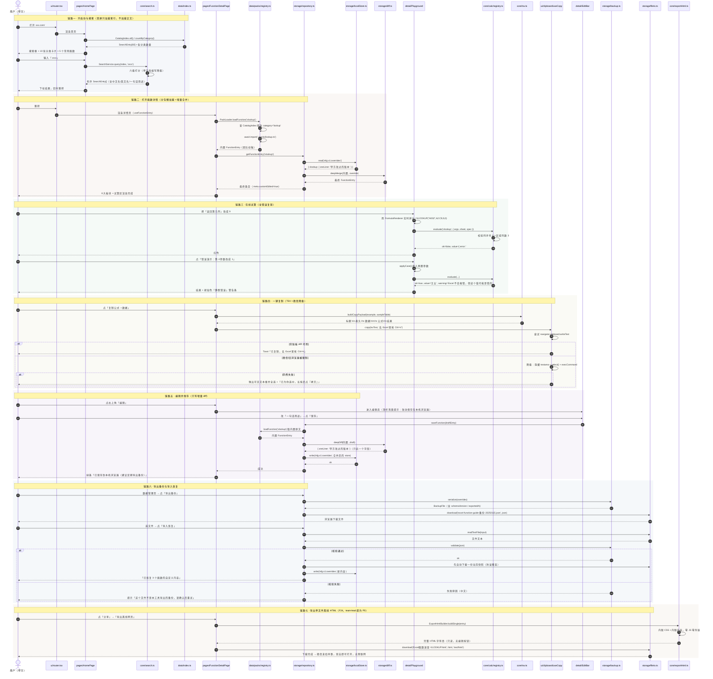
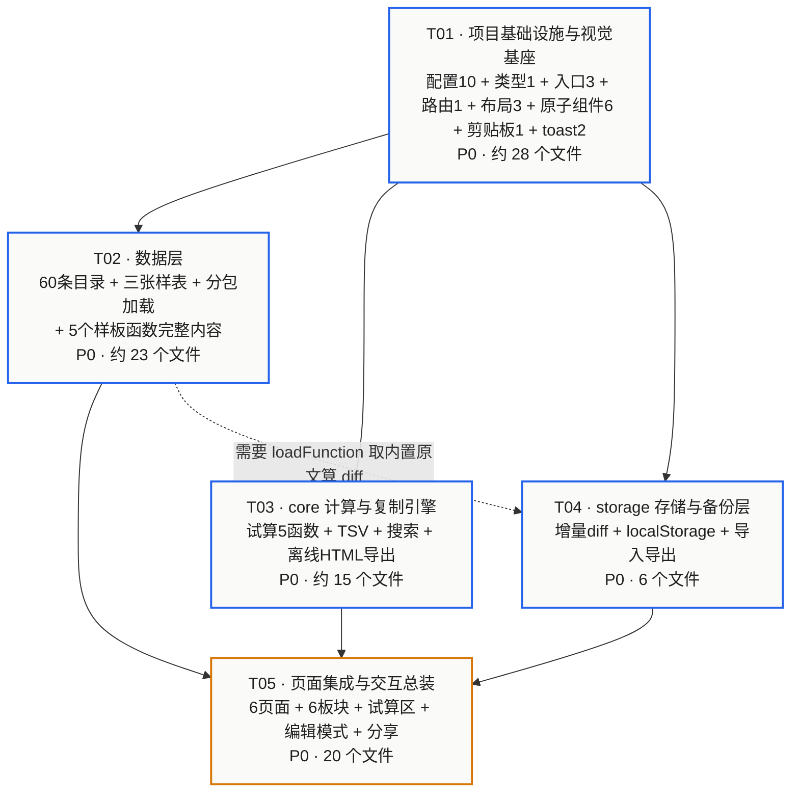

# Excel 函数速查网页 · 系统架构设计与任务分解

| 项目 | 内容 |
|---|---|
| 文档性质 | **架构设计 + 任务分解**（架构师高见远 / Bob 出品） |
| 上游输入 | `docs/PRD.md`（v1.1 主文档）、`docs/PRD-补充与复核.md`（增补件，冲突时以增补件与本文「team-lead 决策」为准） |
| 适用版本 | 第一版：**完整框架 + 5 个样板函数**（VLOOKUP / SUMIFS / IF / XLOOKUP / TEXT） |
| 读者 | 甲方（可只读第 1、2、7 章）、开发工程师（全读）、team-lead |
| 配套文件 | `docs/class-diagram.mermaid`（类图）、`docs/sequence-diagram.mermaid`（时序图） |

---

## 0. 给甲方的一段话（30 秒看懂这份文档在说什么）

您要的这个东西，技术上拆成四层**互不打搅**的「抽屉」：

| 抽屉 | 装什么 | 换掉它的代价 |
|---|---|---|
| **data 数据层** | 60 个函数的全部文字内容、三张示例业务表 | 换内容 = 换抽屉里的纸，其他不动 |
| **core 计算层** | 在线试算的算数逻辑、搜索、复制格式、导出排版 | 这是一台「纯算数的机器」，不碰屏幕、不碰网络 |
| **storage 存储层** | 您改过的内容存在哪里、怎么导出备份 | 换存储位置（本机 → 云端 → 手机）只动这一层 |
| **ui 界面层** | 手机上 / 电脑上看到的那些按钮和排版 | 换界面只动这一层 |

**这四个抽屉分开装，是为了一件事**：将来您想把它变成手机 App，我们只需要换掉「存储」和「界面」两个抽屉，中间那台「算数机器」和 60 个函数的内容一个字都不用改——这就是您要求的「预留转 App 能力」的具体做法。

---

# Part A · 系统设计

## 1. 实现方案与框架选型

### 1.1 这个项目真正的 5 个难点（先说清楚难在哪，才知道为什么这么选）

| # | 难点 | 为什么难（人话） | 本设计的解法 |
|---|---|---|---|
| **N1** | **在线试算要能「故意算错」** | 一般做法是接一个现成的 Excel 公式引擎（如 HyperFormula / Formula.js），输入公式直接出结果。但我们要的恰恰相反——**要能点一下按钮就复现 `#N/A`、`#REF!`，并且用中文解释「为什么会错、怎么改」**。现成引擎的错误信息是英文的、不可控的，也没法做「第 4 参数填 1 且首列没排序 → 不报错但查出来是别人」这种业务化的坑 | **自研 5 个纯函数**，每个函数自己判断参数、自己抛 `{error, reason, fix}` 结构化中文错误。5 个函数代码量可控，完全可控、可测、可扩展 |
| **N2** | **复制的内容必须粘进 Excel 自动分列** | 网页上看到的是一张表格，但直接复制富文本，Excel 会把整块塞进一个单元格，用户还得手动「分列」——这一步能劝退一半人 | **复制载荷统一走 TSV**（单元格之间用 Tab 分隔、行之间用换行）。这是 Excel 剪贴板的原生语言，粘贴即分列。由 `core/tsv.ts` 统一生产，UI 只负责触发 |
| **N3** | **甲方改的内容不能被我们未来的更新冲掉** | 我们以后会修正/补充官方内容（数据层会变），但甲方已经在网页上改过自己的版本。直接全量存会冲突，直接覆盖会丢改动 | **存储层只存「增量 diff」**（改了哪个字段就存哪个字段），读取时 `内置 JSON ⋈ 增量 diff = 最终内容`。我们更新内置内容，甲方的改动自动叠加在上面 |
| **N4** | **分享给同事必须「双击就能看」** | 发链接在纯静态托管上会 404（服务器没有 `/f/vlookup` 这个文件夹）；发备份 JSON 对方打开是一堆代码符号，等于没发 | ① **hash 路由** `#/f/vlookup`（`#` 后面不发给服务器，任何托管都能打开）② **导出单文件离线 `.html`**（内联 CSS + 内联内容，零依赖，微信发过去双击就看） |
| **N5** | **搜索必须「搜得准」，但拼音会撞车** | 「现在 / 现值 / 选择」的拼音首字母都是 `xz`；「与 / 右 / 月」都是 `y`。用户是**记不清名字才来搜的**，搜不准 = 产品报废 | 搜索索引**同时收录首字母（`abbr`）与全拼（`pinyin`）**，命中后按**六级规则排序**，且单字母缩写不做高置信命中。下拉每条强制显示「中文名 · 英文名 · 一句话用途」三要素，撞车也不误点 |

### 1.2 框架选型与理由（人话版）

| 选择 | 选了什么 | 为什么这么选（甲方能听懂的版本） | 为什么**不选**别的 |
|---|---|---|---|
| 构建工具 | **Vite 5** | 改一行代码，屏幕上 0.1 秒就变，不用等。最后打包成一个文件夹，扔到任何地方都能跑 | Webpack 启动慢、配置啰嗦 |
| UI 框架 | **React 18** | 生态最大、招人最容易、组件化最成熟；将来要套 Capacitor 转 App，React 是最稳的一条路 | Vue 也很好，但「将来转 App」这条路上 React 的现成方案更多 |
| 语言 | **TypeScript** | 60 个函数的数据结构字段很多（一个函数 20+ 字段），用 TS 可以在**写代码的时候**就发现「这个字段写错了」，而不是等甲方打开页面才发现 | 纯 JS 省事，但这种「结构化内容型」项目，类型是最便宜的保险 |
| 样式 | **Tailwind CSS 3** | 设计稿要求的「白底 + 0.5px 细线 + 大留白」本质是**一套固定的间距/色值/字号规范**。Tailwind 让我们把这套规范写成配置，全站自动统一，不会出现「这个按钮 15px、那个 16px」 | ❌ **不引入 MUI**：MUI 自带 Material Design 的阴影、圆角、强调色调，跟「禁阴影、禁渐变、极简」的视觉规范是**打架的**，改它比自己写还累。❌ 也不写大段 CSS 文件：Tailwind 的原子类天然防抖 |
| 路由 | **react-router-dom 6 的 `createHashRouter`** | 直接产出 `#/f/vlookup` 这种链接，浏览器前进/后退、参数解析都现成，不用我们自己造轮子 | 自己写 hash 路由也要 80 行，但浏览器兼容、滚动恢复、参数编解码这些坑容易踩 |
| 公式引擎 | **自研纯函数**（`src/core/calc/`） | 见 N1：我们需要**完全可控的中文错误解释**和**故意制造错误**的能力，现成引擎给不了。而且第一版只有 5 个函数，自研成本可控 | ❌ **不用 HyperFormula / Formula.js**：它们体积大（300KB+）、错误信息英文、无法针对「第 4 参数填 1 且没排序」这种业务坑做定制解释。我们只要 5 个函数，杀鸡不用牛刀 |
| 拼音 | **pinyin-pro**（**仅构建脚本用**） | 60 个函数的拼音**禁止手填**（PRD §7.14）：手填必错，且甲方改了中文名拼音要同步改。用脚本从中文名自动生成，改完跑一次 `npm run gen:pinyin` 即可，顺便做冲突检测 | 手填 = 60 行里必有错字 |
| 单测 | **Vitest**（仅测 core 层） | core 是纯函数、不碰屏幕，最好测。5 个计算函数各写一组断言，保证「试算结果 = Excel 结果」这条验收线（A4）不会悄悄退化 | 不追求覆盖率，只守住计算正确性这一条命 |
| 状态管理 | **不引入**（React 自带 `useState/useReducer` + 自定义 hook） | 全站只有「当前函数条目 + 编辑草稿 + 搜索关键词 + toast」四处状态，引入 Redux/Zustand 是过度设计 | 本项目没有跨页共享的复杂状态 |

**一句话总结选型思路**：**能不装就不装**。整个项目生产环境只有 3 个依赖（react / react-dom / react-router-dom），其余全是构建期工具。依赖越少，将来甲方自己部署、自己改动越不容易踩坑。

### 1.3 四层架构（这是本文档最重要的一张图）

```
┌──────────────────────────────────────────────────────────────────────┐
│  ui/        界面层   只看得见屏幕：页面、组件、路由、剪贴板交互          │
│                      ✅ 允许用 window / document / localStorage        │
│                      ❌ 不允许自己算 VLOOKUP，必须问 core              │
└───────────────┬──────────────────────────────────────────────────────┘
                │ 单向依赖（只能往下调，不能往上调）
┌───────────────▼──────────────────────────────────────────────────────┐
│  storage/    存储层   管「甲方改过什么」：增量 diff、localStorage、      │
│                      导入导出备份、文件下载                            │
│                      ✅ 唯一允许碰 localStorage / Blob / File 的地方    │
│                      ❌ 不认识任何 React 组件                          │
└───────────────┬──────────────────────────────────────────────────────┘
                │
┌───────────────▼──────────────────────────────────────────────────────┐
│  core/       计算层   「纯算数的机器」：试算引擎、搜索排序、TSV、        │
│                      公式拼装、离线 HTML 生成                          │
│                      ❌ 禁止 import 任何 window / document / storage    │
│                      ❌ 禁止 import React                              │
│                      → 可以在 Node 里直接跑单测，将来可搬到 App / 后端   │
└───────────────┬──────────────────────────────────────────────────────┘
                │
┌───────────────▼──────────────────────────────────────────────────────┐
│  data/       数据层   纯数据：60 条目录、10 个分类包、5 个样板内容、     │
│                      三张统一样表                                     │
│                      ❌ 不含任何逻辑，只有常量 + 一个懒加载器            │
└──────────────────────────────────────────────────────────────────────┘
```

**四条铁律（工程师请贴在屏幕旁）**：

1. `core/` 里出现 `window`、`document`、`localStorage`、`import React` → **直接驳回**。
2. `ui/` 里出现 `if (colIndex === 0) return '#VALUE!'` 这种计算逻辑 → **直接驳回**，必须下沉到 `core/calc/`。
3. `ui/` 里出现 `localStorage.getItem(...)` → **直接驳回**，必须走 `storage/repository.ts`。
4. 任何一层都不允许**反向** import（data 不认识 core，core 不认识 storage，storage 不认识 ui）。

> 📘 **为什么这么严格**：这就是 team-lead 说的「将来只换 storage 和 ui 两层即可用 Capacitor 套壳」。四层分离不是画着好看的——它是**用 import 方向强制出来的**。只要方向不乱，将来 `storage/` 换成 Capacitor Preferences + SQLite、`ui/` 换成移动端壳，`core/` 和 `data/` 一行不改。

### 1.4 关键架构决策（ADR，逐条说明「为什么」）

| ID | 决策 | 理由与替代方案对比 |
|---|---|---|
| **A1** | 计算层自研，不引第三方公式引擎 | 见 N1。5 个函数的实现量约 600–900 行，换来 100% 可控的中文错误文案与「错误配方」复现能力。将来若需要覆盖 60 个函数，可在 `calc/registry.ts` 里**逐函数**切换实现（保留 `engine` 字段做预留），不必推翻重来 |
| **A2** | 存储只存增量 diff，读取时深合并 | 见 N3。**数组整体替换、对象按 key 合并**（数组做增量合并会产生半截数据，风险远大于收益）。「恢复官方原文」= 删掉该 id 的 diff，天然幂等 |
| **A3** | hash 路由（`createHashRouter`） | 见 N4。静态托管零配置 100% 可用。代价只是链接里多一个 `#` |
| **A4** | 复制载荷统一由 `core/tsv.ts` 生产 | 见 N2。**复制顺序固定**：① 示例标题行 → ② 数据表（表头 + 数据行）→ ③ **空一行** → ④ 公式 → ⑤ 结果。UI 只调 `buildCopyPayload()`，不允许各页面自己拼字符串 |
| **A5** | 数据按分类分包 + 首屏只加载索引 | 见 F28。首屏索引 ≈ 60 条 × 约 12 字段 ≈ 30–40KB（gzip 后 <10KB），**随代码打包**不额外发请求；点进详情页时再 `import()` 对应分类包。首版包体很小（早期样本函数为占位），但**分包机制必须现在就位**，否则全部函数内容填满后要重构加载层 |
| **A6** | 拼音字段由构建脚本生成，禁止手填 | PRD §7.14。脚本读 `catalog.json` → 用 pinyin-pro 生成 → **写回原文件**（幂等）→ 跑冲突检测并打印报告。中文名一改，跑一次 `npm run gen:pinyin` |
| **A7** | 中文名存疑的函数用 `zhName: null` 表达「英文名为主显示」 | 见 §3.4。这是**数据驱动**的：把 `null` 改成「文本合并」就能一键切回中文优先显示，不用改任何代码 |
| **A8** | 离线 HTML 导出在 `core/` 里用字符串拼接，不用任何 DOM/JSX | 保证它是纯函数、可单测、不依赖 React 运行时。导出的 `.html` **内联全部 CSS、零 JS、零外链**，微信发过去断网也能看 |
| **A9** | 剪贴板统一走 `ui/clipboard/useCopy.ts`，失败自动降级 | 见 F25。降级策略：`navigator.clipboard.writeText` → 失败 → 隐藏 `textarea` + `select()` + `document.execCommand('copy')` → 仍失败 → 弹出可见文本框并全选 + 「已为你选中，长按后点『拷贝』」。**禁止**向用户暴露「剪贴板 API 调用失败」这类技术文案 |

---

## 2. 完整文件列表

> 共 **64 个文件**。每个文件职责一句话，工程师照此建目录即可。

### 2.1 根目录与配置（10 个）

| 路径 | 职责（一句话） |
|---|---|
| `package.json` | 依赖声明与脚本入口（`dev` / `build` / `preview` / `gen:pinyin` / `test`） |
| `vite.config.ts` | Vite 配置：React 插件、`base: './'`（保证任意子目录托管都能打开）、构建分包 |
| `tsconfig.json` | TS 编译配置（严格模式 + 路径别名 `@/` → `src/`） |
| `tsconfig.node.json` | 给 Vite 配置文件和 `scripts/` 用的独立 TS/Node 配置 |
| `tailwind.config.js` | 把 PRD 第 8 章的设计规范（色值 / 字号 / 行高 / 间距 / 圆角 / 断点）落成 Tailwind 主题 token |
| `postcss.config.js` | PostCSS 配置（Tailwind + Autoprefixer） |
| `index.html` | HTML 入口，含 `#root`、中文 `lang="zh-CN"`、viewport、主题色 meta |
| `.gitignore` | 忽略 `node_modules` / `dist` / 编辑器与系统垃圾文件 |
| `.eslintrc.cjs` | 轻量 ESLint 规则（只开 react-hooks + 未使用变量，**不做格式化军规**） |
| `README.md` | 30 秒上手：装依赖 → 起服务 → 打包 → 跑拼音脚本；附架构四层说明 |

### 2.2 构建脚本（1 个）

| 路径 | 职责（一句话） |
|---|---|
| `scripts/gen-pinyin.mjs` | 读 `src/data/catalog.json`，用 pinyin-pro 生成 `abbr` / `pinyin` 并**写回原文件**（幂等），最后跑拼音冲突检测并打印报告 |

### 2.3 类型定义（1 个）

| 路径 | 职责（一句话） |
|---|---|
| `src/types/index.ts` | **全站唯一类型真源**：`FunctionEntry` / `ArgItem` / `ExampleItem` / `PitfallItem` / `CalcSpec` 等全部类型（详见第 3 章） |

### 2.4 data 层（22 个）

| 路径 | 职责（一句话） |
|---|---|
| `src/data/categories.ts` | 10 个分类的 id / 中文名 / 排序 / 一句话说明 |
| `src/data/catalog.json` | **60 条函数「身份证」唯一手工真源**：id / 中英文名 / 俗称 / 别名 / 分类 / 难度 / 常用度 / 最低版本 / 一句话用途 / 发布状态（拼音字段由脚本写回） |
| `src/data/index.ts` | 数据层门面：把 catalog 派生为 `SearchEntry[]`、分类计数、按 id 查元信息；不加载正文 |
| `src/data/sampleTables.ts` | 三张统一业务样表的常量（员工表 8 行 / 销售明细表 12 行 / 考勤记录表 10 行） |
| `src/data/stubFactory.ts` | `stub()` 工厂：用一行调用生成一个「内容待补充」占位条目 |
| `src/data/loadFunction.ts` | 按 id → 查分类 → 动态 `import()` 对应分类包 → 返回内置 `FunctionEntry`（纯函数，不碰存储） |
| `src/data/packs/registry.ts` | 分类 id → 动态 import 函数的映射表（分包懒加载的唯一入口） |
| `src/data/packs/logical.ts` | 逻辑类 6 条（含样板 `if`） |
| `src/data/packs/text.ts` | 文本类 10 条（含样板 `text`） |
| `src/data/packs/datetime.ts` | 日期与时间类 8 条 |
| `src/data/packs/lookup.ts` | 查找与引用类 9 条（含样板 `vlookup` / `xlookup`） |
| `src/data/packs/math.ts` | 数学与三角类 8 条（含样板 `sumifs`） |
| `src/data/packs/statistical.ts` | 统计类 9 条 |
| `src/data/packs/financial.ts` | 财务类 5 条 |
| `src/data/packs/information.ts` | 信息类 3 条 |
| `src/data/packs/engineering.ts` | 工程类 1 条 |
| `src/data/packs/database.ts` | 数据库类 1 条 |
| `src/data/samples/{vlookup,sumifs,if,xlookup,text}.ts` | **5 个样板函数的完整内容**（各 1 个文件，共 5 个文件，见下表） |

> 上表最后一行展开为 5 个文件：`src/data/samples/vlookup.ts`、`sumifs.ts`、`if.ts`、`xlookup.ts`、`text.ts`。
> 合计：17 行中的前 16 个文件 + samples 5 个 = **22 个**。

### 2.5 core 层（15 个）

| 路径 | 职责（一句话） |
|---|---|
| `src/core/errors.ts` | 错误码常量 + `{error, reason, fix}` 构造器 + 按「函数 id + 错误码 + 场景」取中文解释的字典 |
| `src/core/tsv.ts` | TSV 解析 / 序列化 + **复制载荷拼装**（标题→数据表→空行→公式→结果）+ 转义规则 |
| `src/core/formula.ts` | 语法/公式模板渲染：把 `=VLOOKUP({lookup_value},...)` 里的占位符替换成用户填的值并做引号处理 |
| `src/core/search.ts` | 六级排序搜索（见 §3.6），纯函数，输入关键词 + 索引，输出有序 id 列表 |
| `src/core/ref.ts` | A1 引用解析：`A2:C9` → 行列坐标；把样表切片成二维数组 |
| `src/core/exportCss.ts` | 离线 HTML 专用的精简内联 CSS 字符串（与 Tailwind token 对齐的静态常量） |
| `src/core/exportHtml.ts` | 把一个 / 全部 `FunctionEntry` 渲染成**零 JS、零外链**的单文件 HTML 字符串 |
| `src/core/calc/types.ts` | 计算层内部类型：`CellValue` / `Sheet` / `CalcOutcome` / `CalcFailure` / `CalcContext` |
| `src/core/calc/registry.ts` | 函数注册表：`Record<fnId, CalcHandler>`，`evaluate(fnId, args, sheet)` 统一入口 + 未注册函数的兜底 |
| `src/core/calc/vlookup.ts` | VLOOKUP 试算实现（精确 / 模糊二分两种匹配 + 6 类错误复现） |
| `src/core/calc/sumifs.ts` | SUMIFS 试算实现（条件解析：比较符 / 通配 / 日期 / 单元格引用 + 5 类错误复现） |
| `src/core/calc/if.ts` | IF 试算实现（条件表达式解析 + 嵌套 + AND/OR + 5 类错误复现） |
| `src/core/calc/xlookup.ts` | XLOOKUP 试算实现（反向查找 / 未找到兜底 / 匹配模式 / 搜索模式 + 5 类错误复现） |
| `src/core/calc/text.ts` | TEXT 试算实现（日期与数字格式代码解释器，覆盖 ≥10 个常用代码） |
| `src/core/calc/calc.spec.ts` | Vitest 用例：5 个函数各 ≥1 组「正确值 + 错误码」断言（守住 A4 验收线） |

> 合计：core 根目录 7 个 + `calc/` 下 8 个 = **15 个文件**。

### 2.6 storage 层（6 个）

| 路径 | 职责（一句话） |
|---|---|
| `src/storage/keys.ts` | 所有 localStorage key 常量 + 备份文件的 `schemaVersion` 常量（改 key 只改这一处） |
| `src/storage/diff.ts` | `deepDiff(内置, 编辑后)` 与 `deepMerge(内置, 增量)`（数组整体替换、对象按 key 合并） |
| `src/storage/localStore.ts` | localStorage 安全读写：try/catch 包住（无痕模式 / 配额满 / 禁用 cookie 都不崩），失败降级到内存 Map |
| `src/storage/fileIo.ts` | 浏览器文件动作：下载文本为文件（Blob）、从 `<input type=file>` 读文本 |
| `src/storage/backup.ts` | 备份文件的**序列化 / 反序列化 / 结构校验**（导入前校验 schemaVersion 与字段，失败给中文提示） |
| `src/storage/repository.ts` | **存储层对外的唯一门面**：`getFunctionEntry(id)`（内置 ⋈ diff）、`saveFunction(entry)`、`resetFunction(id)`、`listOverrides()`、`exportBackup()`、`importBackup()` |

### 2.7 ui 层（36 个）

| 路径 | 职责（一句话） |
|---|---|
| `src/main.tsx` | React 挂载入口 + 全局样式引入 |
| `src/App.tsx` | 应用根组件：路由 Provider + AppShell + Toast 容器 + 一次性「数据存本机」引导条 |
| `src/styles/index.css` | Tailwind 三条指令 + 少量全局基线（字体栈、0.5px 细线的实现、代码块滚动条、禁止 tap 高亮） |
| `src/ui/router.tsx` | hash 路由表（`/`、`/category/:id`、`/search`、`/f/:id`、`/data`、`/about`、`*`） |
| `src/ui/layout/AppShell.tsx` | 页面骨架：顶栏 + 760px 居中内容区 + 页脚 + 路由出口 |
| `src/ui/layout/Header.tsx` | 顶栏：站点名 + 全局搜索入口（移动端）+ 数据管理/关于链接 |
| `src/ui/layout/Footer.tsx` | 页脚：数据管理 / 关于与免责 / 版本号 |
| `src/ui/components/Badge.tsx` | 分类徽章 / 难度徽章 / 状态徽章（高度 20px、4px 圆角、无阴影） |
| `src/ui/components/CodeBlock.tsx` | 等宽公式块：横向滚动不换行 + 右上角复制小图标 |
| `src/ui/components/DataTable.tsx` | 示例数据表：0.5px 横向细线、无纵向线、移动端可横滑 |
| `src/ui/components/CopyButton.tsx` | 复制按钮：调 `useCopy`，自带成功/降级两种状态文案 |
| `src/ui/components/Toast.tsx` | 顶部轻提示（复制成功 / 已保存 / 导入结果），2 秒淡出 |
| `src/ui/components/EmptyState.tsx` | 空态：「没找到『xxx』，你要找的是不是：」+ 3 个相近函数 |
| `src/ui/components/SectionTitle.tsx` | 详情页 6 大板块的编号标题（①②③…） |
| `src/ui/components/VersionNotice.tsx` | **版本与兼容性提示条**：最低可用版本 + 旧版替代写法 + 隐藏函数/动态数组提示 |
| `src/ui/components/SearchBox.tsx` | 搜索框 + 即时下拉结果（三要素展示 + 键盘上下选择 + 无结果空态） |
| `src/ui/components/FunctionCard.tsx` | 列表项卡片：中文名 + 英文名（等宽小字）+ 一句话用途 + 徽章 |
| `src/ui/components/CategoryCard.tsx` | 首页分类卡片：分类名 + 函数数量 + 3 个代表函数 |
| `src/ui/clipboard/useCopy.ts` | **剪贴板唯一出口**：Clipboard API → execCommand → 选中降级（F25），统一中文文案 |
| `src/ui/hooks/useToast.ts` | toast 队列的全局 hook（配合 `Toast.tsx`） |
| `src/ui/hooks/useFunctionEntry.ts` | 详情页数据 hook：分包加载 + diff 合并 + loading/error 三态 |
| `src/ui/hooks/useEditDraft.ts` | 编辑模式 hook：草稿 state、脏检查、保存/取消/恢复原文 |
| `src/ui/pages/HomePage.tsx` | 首页：搜索 + 10 个分类卡片 + 5 个常用函数快捷入口 + 中文名助记说明 |
| `src/ui/pages/CategoryPage.tsx` | 分类列表页（按分类过滤索引） |
| `src/ui/pages/SearchPage.tsx` | 搜索结果页（复用列表布局，读 `?q=`） |
| `src/ui/pages/FunctionDetailPage.tsx` | **核心详情页**：装配 6 板块 + 试算区 + 分享/导出/编辑按钮组 |
| `src/ui/pages/DataPage.tsx` | 数据管理页：状态卡片 + 导出备份 + 导入恢复 + 恢复官方原文 + 隐私说明 |
| `src/ui/pages/AboutPage.tsx` | 关于页：产品说明 + 试算免责声明全文 + 版本记录 |
| `src/ui/detail/SectionOneLiner.tsx` | 板块①一句话用途（含「中文名是助记名，往 Excel 里输入请用英文名」提示） |
| `src/ui/detail/SectionSyntax.tsx` | 板块②语法结构：中文占位符行 + 英文原式行，点参数高亮下方说明 |
| `src/ui/detail/SectionArgs.tsx` | 板块③参数逐项说明（4 要素：填什么/能填什么/不填会怎样/填错会怎样） |
| `src/ui/detail/SectionExamples.tsx` | 板块④真实示例卡片（每个示例两个复制按钮） |
| `src/ui/detail/SectionPitfalls.tsx` | 板块⑤常见错误与注意事项（错在哪→为什么→怎么改） |
| `src/ui/detail/SectionRelated.tsx` | 板块⑥相关函数推荐（标注 易混淆/可替代/常搭配 + 什么时候改用） |
| `src/ui/detail/Playground.tsx` | **在线试算区**：参数表单 + 公式实时回显 + 结果/错误展示 + 错误演示按钮排 + 常驻免责声明 |
| `src/ui/detail/EditBar.tsx` | 编辑模式底部常驻操作条 + 顶部浅黄编辑态提示条 |

> 合计：入口与样式 4 个 + `layout/` 3 个 + `components/` 11 个 + `clipboard/` 1 个 + `hooks/` 3 个 + `pages/` 6 个 + `detail/` 8 个 = **36 个文件**。

### 2.8 文件总数核对

| 层 | 文件数 |
|---|---|
| 根目录配置 | 10 |
| `scripts/` | 1 |
| `src/types/` | 1 |
| `src/data/` | 22（含 `samples/` 5 个、`packs/` 11 个） |
| `src/core/` | 15（含 `calc/` 8 个） |
| `src/storage/` | 6 |
| `src/ui/` | 36 |
| `public/` | 1（`favicon.svg`） |
| **合计** | **92**（其中 `src/` 下 80 个） |

> 任务列表 T01–T05 覆盖的 92 个文件与此处**逐一对齐**：28 + 23 + 15 + 6 + 20 = 92。

---

## 3. 数据结构与接口定义

### 3.1 全量 TypeScript 类型定义（`src/types/index.ts`）

> 工程师请**原样复制**这一节到 `src/types/index.ts`，不要自由发挥字段名。
> 与 PRD §6.2 的差异已在注释中标出（差异原因：以 PRD §10.4 / §10.5 的写作规范与 team-lead 决策为准）。

```ts
/* =========================================================================
 * 0. 基础别名
 * ========================================================================= */

/** 10 个分类 id（与 PRD §7.1 一致） */
export type CategoryId =
  | 'logical' | 'text' | 'datetime' | 'lookup'
  | 'math'   | 'statistical' | 'financial'
  | 'information' | 'engineering' | 'database';

/** 三张统一业务样表 id（PRD §10.5.1） */
export type SampleTableId = 'employee' | 'sales' | 'attendance';

/** 内容发布状态：draft = 内容待补充（55 个占位函数） */
export type EntryStatus = 'published' | 'draft';

/** 踩坑频率 */
export type PitfallLevel = 'high' | 'mid' | 'low';

/** 相关函数的关系类型 */
export type RelatedKind = 'confusable' | 'alternative' | 'companion';

/** 难度星级 1–5 */
export type Difficulty = 1 | 2 | 3 | 4 | 5;

/** Excel 最低可用版本代号 */
export type ExcelMinVersion =
  | 'all'    // 全部版本（Excel 2003 起）
  | '2007'   // Excel 2007 起
  | '2019'   // Excel 2019 / 2021 / Microsoft 365
  | '365';   // 仅 Microsoft 365 / Excel 2021 及以上

/* =========================================================================
 * 1. 版本与兼容性（team-lead Q9 决策的落地字段）
 * ========================================================================= */

export interface VersionInfo {
  /** 精确的最低可用版本代号 */
  min: ExcelMinVersion;
  /**
   * 展示用文案，**按 team-lead 口径措辞**：
   * XLOOKUP/FILTER → '需 Microsoft 365 或 Excel 2021 及以上，旧版无此函数'
   * TEXTJOIN/CONCAT/IFS → '需 Excel 2019 / 2021 或 Microsoft 365，Excel 2016 及更早版本无此函数'
   */
  label: string;
  /**
   * 旧版替代写法 —— team-lead 明确要求：新函数**必须**给出。
   * 例：XLOOKUP → { expr: '=INDEX(B2:B9,MATCH(F2,A2:A9,0))', note: '用 INDEX+MATCH 组合，功能等价，全版本可用' }
   */
  legacyAlternative?: {
    /** 可直接复制的替代公式 */
    expr: string;
    /** 一句人话：什么时候用它、有没有功能损失 */
    note: string;
  };
  /** 附加提示，如 DATEDIF 的隐藏函数提示、UNIQUE/FILTER 的动态数组溢出提示 */
  notes?: string;
}

/* =========================================================================
 * 2. 参数说明 —— ArgItem
 * ========================================================================= */

export interface ArgItem {
  /** 参数占位 key，与 syntax.patternCn / patternEn 中的 {key} 一一对应 */
  key: string;
  /** 参数中文名，如 '查找值' */
  zh: string;
  /** 参数英文名，如 'lookup_value' */
  en: string;
  /** 是否必填。选填参数在语法行里必须用 [ ] 包起来 */
  required: boolean;
  /** ① 填什么：一句话说明 */
  desc: string;
  /** ② 能填什么：枚举常见取值，如 '0 精确匹配 / 1 模糊匹配 / TRUE / FALSE' */
  accepts?: string;
  /** ③ 不填会怎样：如 '省略等于模糊匹配，要求首列已升序排序' */
  ifOmitted?: string;
  /** ④ 填错会怎样 / 小技巧 */
  tip?: string;
  /** 该参数的一个填空样例，如 '$A$2:$C$100' */
  example?: string;
  /**
   * 踩坑排名：1 = 最常填错的参数。
   * PRD §10.5.2：参数超过 4 个时必须标注。
   */
  pitfallRank?: number;
}

/* =========================================================================
 * 3. 示例 —— ExampleItem
 * ========================================================================= */

export interface ExampleItem {
  /** 场景标题，如 '示例 1：按工号查姓名（精确匹配）' */
  title: string;
  /** 场景描述：一段话讲清「什么情况下你会遇到这个问题」 */
  scene: string;
  /**
   * 优先引用三张统一样表之一（PRD §10.5.1）。
   * 与 dataTsv 二选一：有 tableId 就用样表，没覆盖到的场景才用 dataTsv。
   */
  tableId?: SampleTableId;
  /** 自定义小表：制表符分隔、\n 分行，含表头。仅当三张样表覆盖不到时使用 */
  dataTsv?: string;
  /** 数据在表格中的起始单元格，用于说明相对引用，如 'A1'（表头所在行） */
  dataAnchor: string;
  /** 公式原文，以 '=' 开头 */
  formula: string;
  /** 结果（文本描述），如 '在 F2 输入 A002 时，返回「李四」' */
  result: string;
  /** 一句话记忆点：这个公式在算什么 */
  explanation: string;
}

/* =========================================================================
 * 4. 注意事项 —— PitfallItem
 * ========================================================================= */

export interface PitfallItem {
  /** 错在哪（现象），如 '第 4 参数忘了写，结果不对但不报错' */
  title: string;
  /** 为什么会错 */
  reason: string;
  /** 怎么改（给可直接抄的公式） */
  fix: string;
  /** 踩坑频率，用于排序：high 优先展示 */
  level: PitfallLevel;
  /** 关联的错误码（若有），如 '#N/A'。用于在页面上以等宽红字高亮 */
  errorCode?: string;
}

/** 相关函数推荐 */
export interface RelatedItem {
  /** 目标函数的 id */
  id: string;
  /** 关系类型 */
  kind: RelatedKind;
  /** 一句「什么时候该用它而不是这个」 */
  why: string;
}

/* =========================================================================
 * 5. 在线试算 —— CalcSpec（PRD §6.2 里叫 playground，此处按 team-lead 口径改名）
 * ========================================================================= */

/** 试算表单字段类型 */
export type CalcFieldType =
  | 'text'      // 自由文本（会自动补引号）
  | 'number'    // 数字
  | 'select'    // 下拉枚举
  | 'ref'       // 区域引用，如 A2:C9（渲染为只读 + 可切换）
  | 'readonly'; // 只读展示（如示例数据表说明）

/** 试算表单的一个字段 */
export interface CalcField {
  /** 与 calc.template 中 {key} 对应的 key */
  key: string;
  /** 中文标签，如 '查找值' */
  label: string;
  type: CalcFieldType;
  /** type='select' 时的枚举项 */
  options?: { label: string; value: string }[];
  /** 默认值（字符串，数字也用字符串存，避免 0 与空串歧义） */
  default: string;
  /** 输入框占位提示 */
  placeholder?: string;
  /** 字段下方的一行小字说明 */
  hint?: string;
  /** type='ref' 时，指向 calc.ranges 中的语义名，如 'table_array' */
  rangeKey?: string;
}

/** 预置用例（含正确演示与错误演示） */
export interface CalcCase {
  /** 按钮文案，如 '❌ 第 4 参数改成 1（模糊匹配）' */
  label: string;
  /** ok = 正确示例；error = 错误演示 */
  type: 'ok' | 'error';
  /** 各参数取值（键为 CalcField.key） */
  values: Record<string, string>;
  /** 预期结果：成功时是结果值，错误时是错误码（如 '#N/A'）。仅用于自测与文档，不参与运行判断 */
  expect: string;
  /** 人话解释 / 修复建议 —— 结果区会原样展示这一段 */
  note: string;
}

/** 在线试算配置 */
export interface CalcSpec {
  /** 是否开放试算（55 个占位函数设为 false） */
  enabled: boolean;
  /** 试算使用的样表；省略则回退到 examples[0].dataTsv */
  sampleTableId?: SampleTableId;
  /**
   * 语义名 → 区域引用。
   * 例：{ table_array: 'A2:C9', lookup_col: 'A2:A9', return_col: 'B2:B9' }
   * 好处：换样表时只改这里，公式模板和计算实现都不用动。
   */
  ranges: Record<string, string>;
  /** 试算表单字段（顺序即渲染顺序） */
  fields: CalcField[];
  /**
   * 公式拼装模板，占位符为 {key}。
   * 例：'=VLOOKUP({lookup_value}, {table_array}, {col_index_num}, {range_lookup})'
   */
  template: string;
  /** 预置用例：至少 1 个 ok + ≥3 个 error（PRD §10.4） */
  cases: CalcCase[];
  /** 预留：将来若要接入第三方引擎，可在此声明引擎名，registry 按此分派 */
  engine?: 'builtin';
}

/* =========================================================================
 * 6. 附加板块（TEXT 的格式代码速查表等）
 * ========================================================================= */

export interface ExtraBlock {
  /** 板块标题，如 '常用格式代码速查' */
  title: string;
  /** 表格表头，如 ['代码', '作用', '示例结果'] */
  header: string[];
  /** 数据行，行数 ≥ 10（TEXT 专用要求） */
  rows: string[][];
  /** 表格后的一段补充说明 */
  note?: string;
}

/* =========================================================================
 * 7. 函数条目 —— FunctionEntry（核心数据结构）
 * ========================================================================= */

export interface FunctionEntry {
  /** 唯一标识，小写英文名，也是网址的一部分，如 'vlookup' */
  id: string;
  /** 英文名（全大写），如 'VLOOKUP' —— 这是唯一能敲进 Excel 的名字 */
  enName: string;
  /**
   * 中文助记名。
   * - 有官方/通用中文叫法 → 填中文，页面主显示为「中文名 + 英文名小字」
   * - **中文版 Excel 不翻译 / 国内无通用叫法 → 填 null**，页面主显示为英文名，
   *   中文俗称全部进 zhCommon（见 §3.4 清单：XLOOKUP/UNIQUE/TEXTJOIN/IFS/DATEDIF/CONCAT/EOMONTH）
   * 改这一个字段即可在两种显示策略间一键切换（ADR-A7）。
   */
  zhName: string | null;
  /** 中文俗称 / 口语叫法，全部进搜索索引的 aliases，如 ['精确查找','高级查找','万能查找'] */
  zhCommon: string[];
  /** 别名 / 用途俗称，如 ['竖向查找','垂直查找','跨表匹配'] */
  alias: string[];
  /** 所属分类 */
  category: CategoryId;
  /** 拼音首字母，如 'zxcz'；zhName 为 null 时为 enName 小写，如 'xlookup'（由脚本生成） */
  abbr: string;
  /** 中文名全拼，如 'zongxiangchazhao'（由脚本生成） */
  pinyin: string;
  /** 用途关键词，支撑「描述你要做什么」的自然语言搜索，如 ['两个表匹配数据','跨表查数据'] */
  keywords: string[];
  /** 难度星级 */
  difficulty: Difficulty;
  /** 常用度排序权重，数字越大越靠前 */
  usageLevel: number;
  /** 最低可用版本与旧版替代写法（team-lead Q9 决策） */
  version: VersionInfo;
  /** 是否为 Excel 隐藏函数（DATEDIF）：无智能提示、函数列表搜不到，页面须额外提醒 */
  hiddenFunction?: boolean;
  /** 是否为动态数组函数（UNIQUE/FILTER）：结果会溢出到多个单元格，试算区须提示 */
  dynamicArray?: boolean;
  /** ① 一句话用途（≤20 字，动词开头，禁止「用于……」官方腔） */
  oneLiner: string;
  /** ① 补充：2–3 句说明「什么时候该用它」 */
  summary: string;
  /** ② 语法结构 */
  syntax: {
    /** 中文占位符行，如 '=VLOOKUP(找什么, 在哪找, 第几列, 匹配方式)'，选填参数用 [ ] 包起来 */
    patternCn: string;
    /** 英文原式行，如 '=VLOOKUP(lookup_value, table_array, col_index_num, [range_lookup])' */
    patternEn: string;
    /** ③ 参数逐项说明 */
    args: ArgItem[];
  };
  /** 返回什么（一句话） */
  returnValue: string;
  /** ④ 真实示例，≥2 个（样板函数建议 3 个：最常用 / 进阶 / 易错对照） */
  examples: ExampleItem[];
  /** ⑤ 常见错误与注意事项，≥3 条（优先收录「不报错但结果错」的坑） */
  pitfalls: PitfallItem[];
  /** ⑥ 相关函数，3–5 个，每个必须标注关系类型 + 一句「什么时候改用」 */
  related: RelatedItem[];
  /** 附加板块（TEXT 必须带一张 ≥10 行的格式代码速查表） */
  extraBlocks?: ExtraBlock[];
  /** ⑦ 在线试算配置 */
  calc: CalcSpec;
  meta: {
    /** 内容最后更新日期，YYYY-MM-DD */
    updatedAt: string;
    /** draft = 内容待补充 */
    status: EntryStatus;
    /** 是否被甲方编辑过（用于数据管理页的「你改过 M 个」统计与恢复原文） */
    customEdited: boolean;
  };
}

/* =========================================================================
 * 8. 目录 / 搜索索引（首屏只加载这一层）
 * ========================================================================= */

/** catalog.json 的一行 —— 60 条函数的「身份证」，唯一手工真源 */
export interface CatalogRow {
  id: string;
  enName: string;
  /** null = 英文名为主显示（见 FunctionEntry.zhName） */
  zhName: string | null;
  /** 中文俗称 */
  zhCommon: string[];
  alias: string[];
  category: CategoryId;
  difficulty: Difficulty;
  usageLevel: number;
  minVersion: ExcelMinVersion;
  /** 一句话用途（与 FunctionEntry.oneLiner 保持一致，脚本可做一致性校验） */
  oneLiner: string;
  status: EntryStatus;
  /** —— 以下两个字段由 scripts/gen-pinyin.mjs 自动生成，请勿手改 —— */
  abbr?: string;
  pinyin?: string;
}

/** 搜索索引条目（由 CatalogIndex 在运行时从 CatalogRow 派生） */
export interface SearchEntry {
  id: string;
  enName: string;
  /** 可能为 null */
  zhName: string | null;
  /** 拼音首字母 */
  abbr: string;
  /** 中文名全拼 */
  pinyin: string;
  /** zhCommon + alias + keywords 的合集，用于第⑥级别名匹配 */
  aliases: string[];
  category: CategoryId;
  oneLiner: string;
  status: EntryStatus;
}

/* =========================================================================
 * 9. core 计算层类型
 * ========================================================================= */

/** 单元格的值 */
export type CellValue = string | number | boolean | null;

/** 一张试算用的二维表（已切片，不含表头） */
export interface Sheet {
  /** 数据区左上角单元格，如 'A2'（表头在上一行） */
  anchor: string;
  /** 列名 */
  header: string[];
  /** 数据行（不含表头） */
  rows: CellValue[][];
}

/**
 * 计算失败 —— 全站统一的错误结构。
 * 这是 team-lead 点名的硬约束：错误必须返回 { error, reason, fix } 三件套。
 */
export interface CalcFailure {
  /** 错误码，如 '#N/A' */
  error: string;
  /** 人话：这个错误是什么意思、为什么会错 */
  reason: string;
  /** 人话：怎么改（能给的尽量给可直接抄的公式） */
  fix: string;
}

/** 计算成功 */
export interface CalcSuccess {
  ok: true;
  /** 原始值 */
  value: CellValue;
  /** 展示文本（已做数字/日期格式化） */
  display: string;
}

/** 计算失败 */
export interface CalcFail {
  ok: false;
  value: CalcFailure;
}

/** 计算结果（判别联合） */
export type CalcOutcome = CalcSuccess | CalcFail;

/** 计算上下文 */
export interface CalcContext {
  /** 试算所用的数据表 */
  sheet: Sheet;
  /** 各参数取值（键为 CalcField.key，值为用户输入的原始字符串） */
  args: Record<string, string>;
  /** 该函数的 CalcSpec（实现里可能需要读 ranges / template） */
  spec: CalcSpec;
}

/** 一个函数的计算实现 */
export type CalcHandler = (ctx: CalcContext) => CalcOutcome;

/* =========================================================================
 * 10. storage 存储层类型
 * ========================================================================= */

/** 深 Partial：用于表达「只改了几个字段」的增量 */
export type DeepPartial<T> = {
  [K in keyof T]?: T[K] extends (infer U)[]
    ? U[]
    : T[K] extends object
      ? DeepPartial<T[K]>
      : T[K];
};

/** 单个函数的增量（数组整体替换，对象按 key 合并） */
export type FunctionOverride = DeepPartial<FunctionEntry>;

/** localStorage 中 `efg:v1:overrides` 的结构 */
export interface OverridesStore {
  schemaVersion: number;
  /** 函数 id → 增量 */
  functions: Record<string, FunctionOverride>;
}

/** 导出的备份文件结构 */
export interface BackupFile {
  schemaVersion: number;
  app: 'excel-function-guide';
  /** ISO 8601 UTC */
  exportedAt: string;
  kind: 'overrides';
  /** 函数 id → 增量 */
  functions: Record<string, FunctionOverride>;
}

/** 站点设置（localStorage `efg:v1:settings`） */
export interface SiteSettings {
  /** 上次导出备份的时间（ISO 8601 UTC），null = 从未导出 */
  lastExportAt: string | null;
  lastImportAt: string | null;
  /** 首屏「数据只存本机」的一次性引导条是否已看过 */
  onboardingSeen: boolean;
}
```

### 3.2 类图（数据模型 + 服务类）

> 完整源文件见 `docs/class-diagram.mermaid`

```mermaid
classDiagram
    direction LR

    %% ---------------- 数据模型（data 层） ----------------
    class CatalogRow {
        +string id
        +string enName
        +string zhName
        +string[] zhCommon
        +string[] alias
        +CategoryId category
        +number difficulty
        +number usageLevel
        +string minVersion
        +string oneLiner
        +string status
        +string abbr
        +string pinyin
    }

    class FunctionEntry {
        +string id
        +string enName
        +string zhName
        +string[] zhCommon
        +string[] alias
        +CategoryId category
        +string abbr
        +string pinyin
        +string[] keywords
        +number difficulty
        +number usageLevel
        +boolean hiddenFunction
        +boolean dynamicArray
        +string oneLiner
        +string summary
        +string returnValue
    }

    class VersionInfo {
        +string min
        +string label
        +string expr
        +string note
        +string notes
    }

    class SyntaxBlock {
        +string patternCn
        +string patternEn
    }

    class ArgItem {
        +string key
        +string zh
        +string en
        +boolean required
        +string desc
        +string accepts
        +string ifOmitted
        +string tip
        +string example
        +number pitfallRank
    }

    class ExampleItem {
        +string title
        +string scene
        +string tableId
        +string dataTsv
        +string dataAnchor
        +string formula
        +string result
        +string explanation
    }

    class PitfallItem {
        +string title
        +string reason
        +string fix
        +string level
        +string errorCode
    }

    class RelatedItem {
        +string id
        +string kind
        +string why
    }

    class ExtraBlock {
        +string title
        +string[] header
        +string[][] rows
        +string note
    }

    class CalcSpec {
        +boolean enabled
        +string sampleTableId
        +Map ranges
        +string template
        +string engine
    }

    class CalcField {
        +string key
        +string label
        +string type
        +Option[] options
        +string default
        +string hint
        +string rangeKey
    }

    class CalcCase {
        +string label
        +string type
        +Map values
        +string expect
        +string note
    }

    class MetaBlock {
        +string updatedAt
        +string status
        +boolean customEdited
    }

    class SearchEntry {
        +string id
        +string enName
        +string zhName
        +string abbr
        +string pinyin
        +string[] aliases
        +string category
        +string oneLiner
        +string status
    }

    class SampleTable {
        +string name
        +string[] columns
        +CellValue[][] rows
        +string anchor
    }

    FunctionEntry *-- VersionInfo : 必填 1
    FunctionEntry *-- SyntaxBlock : 必填 1
    FunctionEntry *-- ArgItem : 3..6
    FunctionEntry *-- ExampleItem : 2..3
    FunctionEntry *-- PitfallItem : 3..5
    FunctionEntry *-- RelatedItem : 3..5
    FunctionEntry *-- CalcSpec : 必填 1
    FunctionEntry *-- MetaBlock : 必填 1
    FunctionEntry o-- ExtraBlock : 可选
    SyntaxBlock *-- ArgItem : 持有
    CalcSpec *-- CalcField : 2..6
    CalcSpec *-- CalcCase : 至少 4
    CatalogRow ..> SearchEntry : 派生

    %% ---------------- core 层（纯函数，零 DOM） ----------------
    class CatalogIndex {
        -CatalogRow[] rows
        -SearchEntry[] index
        +SearchEntry[] all()
        +SearchEntry get(id)
        +SearchEntry[] byCategory(categoryId)
        +number countByCategory(categoryId)
    }

    class PackLoader {
        -Map loaders
        +Promise loadPack(categoryId)
        +Promise loadFunction(id)
    }

    class SearchService {
        +SearchEntry[] query(index, keyword, limit)
        -number score(entry, keyword)
    }

    class TsvUtils {
        +string[][] parse(tsv)
        +string stringify(rows)
        +string buildCopyPayload(example, sampleTable)
        +string escape(cell)
    }

    class FormulaRenderer {
        +string render(template, args)
        +string quoteIfText(raw)
    }

    class RefResolver {
        +Range parseRef(ref)
        +Sheet slice(table, ref)
        +CellValue[][] resolve(sheet, ref)
    }

    class CalcEngine {
        -Map handlers
        +CalcOutcome evaluate(fnId, ctx)
        +boolean supports(fnId)
    }

    class CalcFailure {
        +string error
        +string reason
        +string fix
    }

    class ErrorLib {
        +CalcFailure make(code, reason, fix)
        +CalcFailure explain(fnId, code, scenario)
        +string[] codes()
    }

    class ExportHtmlBuilder {
        +string buildSingle(entry)
        +string buildAll(entries)
        -string renderSection(entry)
    }

    CatalogIndex ..> SearchEntry : 生成
    CatalogIndex <.. PackLoader : 查分类
    SearchService ..> SearchEntry : 检索排序
    CalcEngine ..> CalcFailure : 失败时返回
    CalcEngine ..> RefResolver : 取区域
    CalcEngine ..> ErrorLib : 取中文解释
    ExportHtmlBuilder ..> TsvUtils : 渲染数据表
    ExportHtmlBuilder ..> FunctionEntry : 只读渲染

    %% ---------------- storage 层 ----------------
    class FunctionRepository {
        +Promise getFunctionEntry(id)
        +void saveFunction(entry)
        +void resetFunction(id)
        +string[] listOverriddenIds()
        +BackupFile exportBackup()
        +Result importBackup(file)
    }

    class LocalStore {
        +T read(key, fallback)
        +boolean write(key, value)
        +void remove(key)
        -Map memoryFallback
    }

    class DiffUtils {
        +DeepPartial deepDiff(base, edited)
        +T deepMerge(base, patch)
    }

    class BackupService {
        +BackupFile serialize(overrides)
        +Result validate(json)
        +OverridesStore deserialize(backup)
    }

    class FileIo {
        +void download(filename, content, mime)
        +Promise readTextFile(input)
    }

    FunctionRepository --> LocalStore : 读写
    FunctionRepository --> DiffUtils : 计算与合并增量
    FunctionRepository --> BackupService : 导入导出
    FunctionRepository ..> PackLoader : 取内置原文
    BackupService --> FileIo : 落盘

    %% ---------------- ui 层 ----------------
    class HashRouter {
        +Route[] routes
        +void navigate(path)
    }

    class FunctionDetailPage {
        -FunctionEntry entry
        -boolean editing
        +void onCopy(kind)
        +void onShare()
        +void onExportHtml()
    }

    class Playground {
        -Record args
        -CalcOutcome outcome
        +void applyCase(calcCase)
        +void reset()
    }

    class EditBar {
        -FunctionEntry draft
        +void save()
        +void cancel()
        +void restoreOfficial()
    }

    class UseCopy {
        +Promise copy(text, hint)
        -boolean tryClipboardApi(text)
        -boolean tryExecCommand(text)
        -void showSelectFallback(text)
    }

    HashRouter --> FunctionDetailPage : 路由 f/id
    FunctionDetailPage --> Playground : 内嵌
    FunctionDetailPage --> EditBar : 编辑态
    FunctionDetailPage ..> FunctionRepository : 读写条目
    Playground ..> CalcEngine : evaluate
    Playground ..> FormulaRenderer : 实时回显公式
    Playground ..> TsvUtils : 复制示例
    EditBar ..> FunctionRepository : saveFunction
    UseCopy ..> FileIo : 离线导出下载
```



### 3.3 计算层统一契约（`core/calc/`）

```ts
// src/core/calc/registry.ts 的核心签名
export function evaluate(fnId: string, ctx: CalcContext): CalcOutcome;

// 未注册的函数（55 个占位函数不应该走到这里，UI 层会先拦）：
// 返回 { ok:false, value:{ error:'#NAME?', reason:'…', fix:'…' } }
```

**5 个样板函数必须覆盖的错误复现清单**（PRD §10.4，工程师照此实现）：

| 函数 | 必须能一键复现的错误（≥3 个，表中列出全部） | 对应错误码 |
|---|---|---|
| **VLOOKUP** | ① 参数 4 = 1 且首列未排序（**不报错但查错人**）② 参数 3 超出列数 ③ 查找值不存在 ④ 区域无 `$` 下拉跑偏 ⑤ 数字存成文本/带空格 ⑥ 参数 3 = 0 | `#N/A` / `#REF!` / `#VALUE!` / 静默错误 |
| **SUMIFS** | ① 条件区域与求和区域行数不一致 ② 条件 `>1000` 忘了加引号 ③ 文本条件 `华东` 不加引号 ④ 日期写成文本 `"2024/3/5"` ⑤ 通配符忘加 `*` / 字面量 `*` 忘转义 | `#VALUE!` / `#NAME?` / 静默错误 |
| **IF** | ① `A1==60` 双等号 ② 返回文字忘加引号 ③ `IF(A1>60 AND A1<80,…)` ④ 嵌套超过 64 层 ⑤ 第三参数省略且条件不成立 | `#NAME?` / 返回 `FALSE` |
| **XLOOKUP** | ① 查找列与返回列行数不一致 ② 旧版 Excel 无此函数 ③ 不填参数 4 且查不到 ④ 通配符模式查数字 ⑤ 二分查找模式但数据未排序（**静默错误**） | `#VALUE!` / `#NAME?` / `#N/A` |
| **TEXT** | ① 格式代码用了中文引号或全角字符 ② 格式代码忘了加引号 ③ `mm` 与 `mmm` 分不清 ④ 把「单元格格式」设置当成格式代码 ⑤ 区域代码 `[$-zh-CN]` 跨机不一致 | `#VALUE!` / `#NAME?` / 静默错误 |

> 📘 **「静默错误」怎么处理**：Excel 不报错但结果错，是最危险的坑。本设计要求这类场景返回的不是 `ok:false`，而是 `ok:true` + 一个 **`warning` 字段**（在 `CalcSuccess` 上扩展 `warning?: string`），UI 用琥珀色提示条展示「Excel 不会报错，但这个值可能是错的」。这样既忠实还原 Excel 行为，又能教育用户。
>
> 工程师实现时请为 `CalcSuccess` 增加：`warning?: string`。

### 3.4 中文名显示策略（team-lead 决策 + PRD §7.13 合并后的最终清单）

**规则**：`zhName: null` → 页面主显示英文名（等宽大号），中文俗称全部进 `zhCommon`（进搜索索引）；`zhName` 有值 → 主显示「中文名 + 英文名小字」。

**采用英文名为主显示（zhName = null）的 7 个函数**：

| # | 函数 | 原因 | 中文俗称（进 zhCommon，全部可被搜到） | abbr（拼音首字母） |
|---|---|---|---|---|
| 1 | **XLOOKUP** | 中文版 Excel 不翻译；team-lead 明确要求 | 精确查找、高级查找、万能查找、扩展查找 | `xlookup`（team-lead 指定；`jccz` 移入 aliases） |
| 2 | **UNIQUE** | 中文版 Excel 不翻译 | 去重、唯一值、不重复列表 | `unique` |
| 3 | **TEXTJOIN** | team-lead 4 个存疑函数之一 | 文本合并、带分隔符合并、拼接 | `textjoin` |
| 4 | **IFS** | 国内无通用叫法 | 多条件判断、多重判断、多分支 | `ifs` |
| 5 | **DATEDIF** | team-lead 4 个存疑函数之一；且是**隐藏函数** | 日期差、算工龄、日期间隔 | `datedif` |
| 6 | **CONCAT** | team-lead 4 个存疑函数之一（在备选池） | 合并、拼接、连接 | `concat` |
| 7 | **EOMONTH** | team-lead 4 个存疑函数之一（在备选池） | 月末、月底、月末日期 | `eomonth` |

> ⚠️ **注意 CONCAT / EOMONTH / FILTER 在 PRD §7.12 备选池里，不在第一版 60 个正式清单内**。本设计照 team-lead 要求把规则先定死；这两个函数若将来从备选池换入，直接按此规则建条目即可，**无需改代码**。
>
> **保留中文助记名**（`zhName` 有值）：其余 53 个 + `CONVERT`（单位换算）+ `DSUM`（数据库求和）—— 这两个按 PRD §7.13「中文名仅作助记」处理，主显示「单位换算 `CONVERT`」。

### 3.5 版本标注口径（team-lead Q9 决策的落地）

| 函数 | `min`（精确值） | `label`（页面显著提示文案） | 旧版替代写法（必须有） |
|---|---|---|---|
| **XLOOKUP** | `365` | 需 Microsoft 365 或 Excel 2021 及以上，旧版无此函数 | `=INDEX(返回列, MATCH(找谁, 查找列, 0))` — 功能等价，全版本可用 |
| **UNIQUE** | `365` | 需 Microsoft 365 或 Excel 2021 及以上；结果会自动溢出到多个单元格 | `高级筛选 → 选择不重复的记录` 或 `=INDEX(…,MATCH(0,COUNTIF(…),0))` 数组公式 |
| **TEXTJOIN** | `2019` | 需 Excel 2019 / 2021 或 Microsoft 365；Excel 2016 及更早版本无此函数 | 用 `&` 逐格连接：`=A2&"、"&B2&"、"&C2` |
| **IFS** | `2019` | 需 Excel 2019 / 2021 或 Microsoft 365；Excel 2016 及更早版本无此函数 | 嵌套 `IF`：`=IF(A1>=90,"优",IF(A1>=80,"良",IF(A1>=60,"及格","不及格")))` |
| **DATEDIF** | `all` | 全版本可用，但这是**隐藏函数**：函数列表里搜不到、输入时没有智能提示，必须手动完整输入 | （无需替代，但须提示隐藏函数属性） |
| 其余 55 个 | `all` / `2007` | 不显示版本提示条 | — |

> ⚙️ **与 team-lead 口径的一处技术校正**（请 team-lead 过目）：team-lead 口徑为「XLOOKUP / FILTER / TEXTJOIN / CONCAT / IFS 需 **Microsoft 365 或 Excel 2021**」。技术事实是：**XLOOKUP / FILTER 确实要 365/2021**，但 **TEXTJOIN / CONCAT / IFS 是 Excel 2019 起就有的**。
> 本设计用 `min`（精确值）+ `label`（展示文案）双字段同时满足两者：UI 提示条一律**显著标注版本要求 + 给出旧版替代写法**（满足 team-lead 要求的用户价值），数据层保留精确版本号（避免 2019 用户被误告知「你用不了」）。
> **若要严格统一成 365/2021 文案，改 `label` 一个字段即可，5 分钟的事。**

### 3.6 搜索六级排序规则（`core/search.ts` 的验收口径）

输入关键词 `q`（已 trim + 转小写），对每个 `SearchEntry` 计算 `score`，**只保留 score > 0 的条目**，然后按 `(score, usageLevel)` 降序排列：

| 级别 | 命中方式 | score | 举例 |
|---|---|---|---|
| ① | `q === enName.toLowerCase()` | 1000 | 输入 `vlookup` |
| ② | `q === zhName`（非空时） | 900 | 输入 `纵向查找` |
| ③ | `pinyin.startsWith(q)` 且 `q.length >= 2` | 800 | 输入 `zongxiang` |
| ④ | `abbr === q` 且 `q.length >= 2` | 600 | 输入 `zxcz` |
| ⑤ | `enName.toLowerCase().startsWith(q)` 且 `q.length >= 2` | 500 | 输入 `vlook` |
| ⑥ | `aliases.some(a => a.includes(q))` | 300 | 输入 `两个表匹配数据` |

**两条硬约束（team-lead 点名，必须实现）**：

1. **单字母缩写不做高置信命中**：`q.length === 1` 时，③④⑤ 三级**全部禁用**（score 记 0），只允许走 ⑥ 别名包含匹配。这样输入 `y` / `z` / `h` 不会弹出一大片无关函数。
2. **下拉每条必须显示「中文名 · 英文名 · 一句话用途」三要素**，撞车时用户自己能分清。

**拼音冲突组的实测验收**（PRD §7.14 / 增补件 §2.1，交付前必须逐条试）：

| 输入 | 期望结果 |
|---|---|
| `y` | **不出现** 与/右/月 的高置信命中（走别名包含，要求 aliases 里没有单字 `y`） |
| `z` | 同上 |
| `xz` | 「现在 NOW / 现值 PV / 选择 CHOOSE」三个都在列表里，**全拼 `xianzai` 输入时能精确命中「现在」** |
| `h` | 不出现「或 OR / 合并 CONCAT」的高置信命中 |
| `ss` | 输入 `sousuozifu` 命中搜索字符；`shifoushuzi` 命中是否数字 |
| `rq` | 输入 `riqicha` 命中日期差；`shengchengriqi` 命中生成日期 |

### 3.7 TSV 复制载荷格式（`core/tsv.ts` 的验收口径）

```
[示例标题行]                    ← 第 1 行：示例 1：按工号查姓名（精确匹配）
[数据表格表头]                  ← 第 2 行：工号\t姓名\t部门
[数据行 1..N]                   ← \t 分隔，\n 分行
                                ← 空一行（必须有，否则 Excel 会把公式接到表格下面）
[公式]                          ← =VLOOKUP(F2,$A$2:$C$4,2,0)
[结果说明]                      ← 结果：在 F2 输入 A002 时，G2 返回「李四」
```

**转义规则**（工程师别漏）：

| 情况 | 处理 |
|---|---|
| 单元格内容本身含 `\t` | 替换为两个空格 |
| 单元格内容含 `\n` | 替换为一个空格 |
| 单元格以 `=` `+` `-` `@` 开头且**不是**我们要的公式 | 前面加一个半角单引号 `'` |
| 单元格首尾空格 | `trim()` |
| 行尾 | 用 `\r\n`（Windows Excel / WPS 兼容性最好） |

**两种复制按钮的产出**：

| 按钮 | 产出 |
|---|---|
| `复制公式` | 只输出公式原文一行（**不加标题、不加结果**），如 `=VLOOKUP(F2,$A$2:$C$4,2,0)` |
| `复制公式 + 数据` | 上面那 5 段完整载荷 |

**验收**：在 Windows Excel、WPS 表格、Mac Excel 三处各粘贴一次，**都必须自动分列**。

### 3.8 存储层增量结构（`storage/` 的验收口径）

```ts
// localStorage key（全部在 src/storage/keys.ts 定义）
'efg:v1:overrides'  // { schemaVersion:1, functions: { vlookup: { oneLiner:'…' } } }
'efg:v1:settings'   // { lastExportAt, lastImportAt, onboardingSeen }
'efg:v1:recent'     // string[]  （P1-09 最近浏览，第一版先存着不展示）
```

**diff 三原则**：

1. **只存差异**：`deepDiff(内置, 编辑后)` 逐字段比较，相同则 omit。
2. **数组整体替换**：`examples` / `pitfalls` / `args` 只要有一项变了，就存整个数组。**不要做数组内逐项 diff**——半截数组的合并 bug 极难排查。
3. **删掉即恢复**：`resetFunction(id)` = `delete functions[id]`，天然幂等，不残留脏数据。

**读取合并**：`deepMerge(内置 FunctionEntry, override)` → 对象逐 key 递归、数组整体覆盖 → 得到最终条目。

**无痕模式 / 配额满降级**：`LocalStore` 全部读写包 try/catch，写失败时降级到内存 `Map` 并在 UI 顶部提示「当前浏览器无法保存（无痕模式？），你的改动只在这次会话有效，请及时导出备份」。**绝不抛异常崩页面**。

---

## 4. 程序调用流程

> 完整源文件见 `docs/sequence-diagram.mermaid`。下面这张图覆盖 7 条主链路：冷启动搜索、打开详情（分包 + diff 合并）、在线试算、复制（TSV + 微信降级）、编辑保存（写 diff）、导出备份 / 导入恢复、导出单文件离线 HTML。



---

## 5. 待明确事项（Anything UNCLEAR）

> 以下 8 项**均不阻塞第一版开工**，已给出默认假设，工程师按假设实现即可；team-lead / 甲方确认后改配置或数据即可，不改架构。

| # | 事项 | 本设计的默认假设 | 若假设错了，改动成本 |
|---|---|---|---|
| **U1** | **TEXTJOIN / CONCAT / IFS 的版本口径**：team-lead 说「365/2021」，技术事实是 2019+ | 按 §3.5：`label` 显著标注「2019/2021/365，2016 及更早无此函数」，`min` 存精确值 | 改 `catalog.json` 里 3 行的 `label`，5 分钟 |
| **U2** | **CONCAT / EOMONTH / FILTER 不在 60 个正式清单内**（在 PRD §7.12 备选池） | 第一版不建正式条目，但 `stubFactory` 与显示规则已支持；若甲方点名换入，改 `catalog.json` 一行 + 对应 pack 一行 | 10 分钟/个 |
| **U3** | **IF 的「成绩 ≥ 60」示例与三张样表冲突**：样表（员工/销售/考勤）里没有成绩字段 | 允许 `ExampleItem.dataTsv` 承载**最小自定义小表**（4 行 2 列：姓名/分数），并在场景描述里注明；IF 的示例 2、3 改用工号/金额场景走样表 | 纯数据，0 代码改动 |
| **U4** | **甲方到底用 Office 还是 WPS、哪一版**（Q9 未给确定答案） | 默认按 Microsoft 365 设计；XLOOKUP/UNIQUE/TEXTJOIN/IFS 页面**一律显著标注版本 + 旧版替代写法**（team-lead 已拍板）。WPS 差异只在「关于页」一句提示 | 若确认是 WPS，补一句提示文案即可 |
| **U5** | **P1-02「打包自定义内容进链接」要不要提前** | 第一版不做。分享链接只带**位置**不带内容，同事看到的是团队初稿——**这个限制必须在分享弹窗里明说**，并引导用「导出离线 HTML」 | P1 补做，改 `backup.ts` 加压缩编码即可 |
| **U6** | **最近浏览（P1-09）第一版要不要展示** | 第一版**只记录不展示**（已预留 `efg:v1:recent` key）。理由：甲方明确说不做收藏/进度，最近浏览容易被误认为「收藏夹」 | 要展示的话加一个组件，半天 |
| **U7** | **PWA 离线可用（P1-08）** | 第一版不做。但 `.html` 单文件导出已能覆盖「微信发过去断网能看」这个真实需求 | 加 `vite-plugin-pwa`，半天 |
| **U8** | **拼音冲突组里 `y` / `z` 单字母的处理** | 单字母**完全不做高置信命中**（§3.6 硬约束 1）。若甲方反馈「我就想输一个 y 找『与』」 | 改 `search.ts` 一行阈值 |

---

# Part B · 任务分解

## 6. 依赖包列表

```jsonc
// dependencies —— 生产环境只有 3 个，其余全是构建期工具
"react": "^18.3.1",              // UI 框架
"react-dom": "^18.3.1",          // React DOM 渲染
"react-router-dom": "^6.26.2",   // hash 路由（createHashRouter）

// devDependencies
"vite": "^5.4.8",                 // 构建工具
"@vitejs/plugin-react": "^4.3.2", // React 热更新插件
"typescript": "^5.6.2",           // 类型系统
"@types/react": "^18.3.11",
"@types/react-dom": "^18.3.0",
"tailwindcss": "^3.4.13",         // 原子化 CSS（把设计规范落成 token）
"postcss": "^8.4.47",
"autoprefixer": "^10.4.20",
"pinyin-pro": "^3.25.0",          // ★ 仅 scripts/gen-pinyin.mjs 使用，不进生产包
"vitest": "^2.1.2",               // 只测 core 层纯函数
"eslint": "^8.57.1",              // 轻量检查（可选，不做格式化军规）
"eslint-plugin-react-hooks": "^4.6.2"
```

**明确不引入**：

| 不引入 | 原因 |
|---|---|
| ❌ `@mui/material` | team-lead 明令：与「简洁清爽、细线、大留白」视觉规范冲突；且体积大、定制成本高 |
| ❌ `formulajs` / `hyperformula` | team-lead 明令：需要完全可控的中文错误解释与「故意制造错误」能力；且第一版只需 5 个函数 |
| ❌ `redux` / `zustand` / `jotai` | 全站仅 4 处局部状态，React 自带足够 |
| ❌ `axios` | 无后端，零网络请求 |
| ❌ `dayjs` / `date-fns` | 日期处理只在 `calc/text.ts` 与 `calc/sumifs.ts` 用到少量逻辑，手写更可控（且避免时区坑） |
| ❌ 任何 UI 组件库 / 图标库 | 图标一律内联 SVG（≤10 个），避免为一个放大镜引一个包 |

---

## 7. 任务列表（按实现顺序，共 5 个任务）

> **工程师照此顺序做**。T01 是地基，T02 / T03 / T04 **可并行**（都只依赖 T01 的类型与视觉基座），T05 最后做总装。

---

### ✅ T01 · 项目基础设施与视觉基座

| 项 | 内容 |
|---|---|
| **任务 ID** | T01 |
| **优先级** | **P0** |
| **依赖** | 无 |
| **交付标准** | `npm run dev` 能起服务，浏览器打开可看到一个符合 PRD 第 8 章视觉规范的空白骨架（顶栏 + 760px 居中内容区 + 页脚），路由可切换，无控制台报错；`npm run build` 能通过 |

**源文件**（28 个）：

```
package.json
vite.config.ts
tsconfig.json
tsconfig.node.json
tailwind.config.js
postcss.config.js
index.html
.gitignore
.eslintrc.cjs
README.md
public/favicon.svg
src/types/index.ts
src/main.tsx
src/App.tsx
src/styles/index.css
src/ui/router.tsx
src/ui/layout/AppShell.tsx
src/ui/layout/Header.tsx
src/ui/layout/Footer.tsx
src/ui/hooks/useToast.ts
src/ui/components/Toast.tsx
src/ui/components/Badge.tsx
src/ui/components/CodeBlock.tsx
src/ui/components/DataTable.tsx
src/ui/components/EmptyState.tsx
src/ui/components/SectionTitle.tsx
src/ui/components/VersionNotice.tsx
src/ui/clipboard/useCopy.ts
```

**要做的事**：

1. **配置层**：`vite.config.ts` 必须设 `base: './'`（保证部署到任意子目录都能打开）；配 `@/` → `src/` 路径别名。
2. **`tailwind.config.js` 是这一任务的重点**——把 PRD 第 8 章落成 token，全站后面都靠它统一：
   - `colors`: `bg:#FFFFFF` / `bg-sub:#FAFAF9` / `bg-edit:#F5F5F3` / `line:#E8E8E6` / `ink:#1F1F1F` / `ink-2:#6B6B6B` / `ink-3:#9B9B9B` / `accent:#2563EB` / `accent-hover:#1D4ED8` / `ok:#16A34A` / `warn:#D97706` / `err:#DC2626` / `code-bg:#F7F7F5`
   - `fontSize`: `h1:32/44` `h2:24/34` `h3:18/28` `h4:16/26` `body:16/28` `sm:14/22` `xs:13/20` `code:15/26`
   - `spacing`: 只允许 4/8/12/16/24/32/48/64（其余值在 review 时打回）
   - `borderRadius`: `card:8px` `btn:6px` `input:6px` `code:6px` `badge:4px` `modal:12px`
   - `maxWidth.content: 760px`
   - `screens`: `sm:640px` `md:1024px`（两段断点，够用）
3. **`src/styles/index.css`**：
   - Tailwind 三条指令
   - 全局字体栈（PRD §8.4，不联网加载字体）
   - **0.5px 细线的实现**：提供 `.hairline` 工具类（`border-width:0.5px`，配 `@media (-webkit-min-device-pixel-ratio:2)`；低分屏降级为 `1px #EDEDEB`）
   - 代码块横向滚动条样式、禁止移动端 tap 高亮、禁止 iOS 输入框自动放大（字号 ≥16px）
4. **`src/types/index.ts`**：**原样复制 §3.1 的全部类型定义**，不要自由发挥字段名。
5. **`src/ui/router.tsx`**：用 `createHashRouter` 建 6 条路由 + `*` 兜底。第一版页面组件可以是占位（T05 填充），但**路由表结构必须建好**。
6. **`src/ui/clipboard/useCopy.ts`（F25，team-lead 提为 P0）**：三级降级，文案全部中文，**禁止**出现「剪贴板 API 调用失败」这类技术提示：
   ```
   ① navigator.clipboard.writeText(text)  → 成功：Toast「已复制，去 Excel 里按 Ctrl+V」
   ② 失败 → 隐藏 textarea + select() + document.execCommand('copy')
   ③ 仍失败 → 弹出可见文本框（autoFocus + select()）+ 提示「已为你选中，长按后点『拷贝』」
   ```
7. **`VersionNotice.tsx`**：版本提示条组件（§3.5），输入 `VersionInfo`，渲染「最低版本 + 旧版替代写法（可复制）+ 隐藏函数/动态数组提示」。第一版只有 XLOOKUP/UNIQUE/TEXTJOIN/IFS 会用到。
8. **原子组件**：`Badge`（分类/难度/状态三种）、`CodeBlock`（等宽 + 横滚 + 复制图标）、`DataTable`（0.5px 横线无纵线 + 移动横滑）、`EmptyState`、`SectionTitle`、`Toast`。

**验收自检**：
- [ ] 无渐变、无 `box-shadow`、无深色底（全局搜一遍 `gradient` / `shadow`）
- [ ] 375 / 768 / 1440 三档宽度下无横向滚动
- [ ] 所有间距值都在 4/8/12/16/24/32/48/64 里
- [ ] 手机上点 `CodeBlock` 的复制按钮能弹出降级文本框（用 Chrome DevTools 模拟禁用剪贴板权限）

---

### ✅ T02 · 数据层：60 条目录 + 5 个样板内容 + 分包加载

| 项 | 内容 |
|---|---|
| **任务 ID** | T02 |
| **优先级** | **P0** |
| **依赖** | T01（需要 `src/types/index.ts`） |
| **交付标准** | 60 个函数条目全部可枚举、可搜索、可按分类统计；5 个样板函数的完整内容（6 板块 + 试算配置）可被 `loadFunction()` 取出；`npm run gen:pinyin` 跑通且冲突检测无 ERROR |

**源文件**（23 个）：

```
scripts/gen-pinyin.mjs
src/data/categories.ts
src/data/catalog.json
src/data/index.ts
src/data/sampleTables.ts
src/data/stubFactory.ts
src/data/loadFunction.ts
src/data/packs/registry.ts
src/data/packs/logical.ts
src/data/packs/text.ts
src/data/packs/datetime.ts
src/data/packs/lookup.ts
src/data/packs/math.ts
src/data/packs/statistical.ts
src/data/packs/financial.ts
src/data/packs/information.ts
src/data/packs/engineering.ts
src/data/packs/database.ts
src/data/samples/vlookup.ts
src/data/samples/sumifs.ts
src/data/samples/if.ts
src/data/samples/xlookup.ts
src/data/samples/text.ts
```

（合计：`packs/` 11 个 + `samples/` 5 个 + `scripts/` 1 个 + data 根目录 6 个 = 23 个）

**要做的事**：

1. **`catalog.json`（60 行）**：按 §3.1 的 `CatalogRow` 建。字段值直接抄 **§附录 A 的 60 行清单表**。`zhName: null` 的 7 个函数见 §3.4。**先不要填 `abbr` / `pinyin`**，交给脚本。
2. **`scripts/gen-pinyin.mjs`**：
   - 读 `src/data/catalog.json`
   - `zhName` 非 null → 用 pinyin-pro 生成 `pinyin`（全拼，无声调）与 `abbr`（首字母）
   - `zhName` 为 null → `pinyin = abbr = enName.toLowerCase()`
   - **写回原文件**（保持 key 顺序、2 空格缩进、末尾换行，保证幂等）
   - **冲突检测**：按 `abbr` 分组，输出冲突组清单；命中 PRD §7.14 的已知 6 组打印 `WARN`，出现**未知的新冲突**或**全拼重复**则 `process.exit(1)` 报 ERROR
   - `package.json` 加脚本：`"gen:pinyin": "node scripts/gen-pinyin.mjs"`
3. **`sampleTables.ts`**：三张样表（PRD §10.5.1）——员工表 8 行 / 销售明细表 12 行 / 考勤记录表 10 行。数据要**真实可信**（张三李四王五、华东华南华北、2024 年的日期），**禁止** `A1/B2` 这类占位。
4. **`stubFactory.ts`**：`stub({id, zhName, enName, category, difficulty, usageLevel, oneLiner})` → 返回一个 `status:'draft'`、`calc.enabled:false`、`examples:[]`、`pitfalls:[]` 的 `FunctionEntry`。用于 55 个占位函数，每个 pack 里一行调用。
5. **10 个 `packs/*.ts`**：每个文件 `export default { ... }` 形式，键为函数 id，值为 `FunctionEntry`。样板函数从 `samples/` import，占位函数用 `stub()`。
6. **`packs/registry.ts`**：`Record<CategoryId, () => import('./xxx.ts')>` 映射表。
7. **`index.ts`**：从 `catalog.json` 派生 `SearchEntry[]`（`aliases = zhCommon + alias + keywords`）、分类计数、按 id 查元信息。**只做派生，不加载正文**。
8. **`loadFunction.ts`**：`loadFunction(id)` → 查 `index.ts` 得分类 → `registry[category]()` → 取 `pack[id]`。找不到返回 `null`。
9. **5 个样板内容（`samples/*.ts`）是这一任务的主体工作量**，严格按 PRD §10.4 的逐个规格写：

| 函数 | 示例数 | 错误演示数 | 特殊要求 |
|---|---|---|---|
| `vlookup` | 3（按工号查姓名 / IFERROR 兜底 / 绝对引用下拉） | 6 | 必须做「参数 4 = 1 且没排序 → 查错人不报错」 |
| `sumifs` | 3（华东区且金额>10000 / 日期区间 / 通配符） | 5 | 讲清日期条件的写法 |
| `if` | 3（达标判断 / 三层嵌套 / AND+OR 组合） | 5 | 第三参数省略返回 FALSE 的坑 |
| `xlookup` | 3（对比 VLOOKUP / 从右往左查 / 自定义未找到提示） | 5 | **必须显著标注版本 + 旧版替代写法** |
| `text` | 3（日期→2024年03月 / 千分位+百分号 / 补前导零） | 5 | **必须额外附 ≥10 行的格式代码速查表**（用 `extraBlocks`） |

**写作口径（照 PRD §10.5.2，工程师请逐条对照）**：
- 一句话用途 ≤20 字、**动词开头**、禁止「用于……」官方腔
- 参数说明 4 要素齐全（填什么 / 能填什么 / 不填会怎样 / 填错会怎样）
- 示例 5 件套：场景一句话 → 数据小表格 → 公式 → 结果 → 一句话记忆点
- 注意事项 ≥3 条，每条「错在哪 → 为什么会错 → 怎么改」，**优先收录「不报错但结果错」的坑**
- 相关函数 3–5 个，标注 易混淆 / 可替代 / 常搭配 + 一句「什么时候改用」
- 示例数据**优先引用三张样表**（`tableId`），覆盖不到才用 `dataTsv`

**验收自检**：
- [ ] `npm run gen:pinyin` 跑通，无未知冲突
- [ ] 输入 `zxcx` 能命中 VLOOKUP；输入 `xlookup` 能命中 XLOOKUP；输入 `jccz` 也能命中 XLOOKUP（走 aliases）
- [ ] 输入 `y` / `z` / `h` **不出现**高置信命中
- [ ] 60 个 id 全部能从 `loadFunction()` 取出（写个临时脚本遍历一遍）

---

### ✅ T03 · core 计算与复制引擎（纯函数，零 DOM）

| 项 | 内容 |
|---|---|
| **任务 ID** | T03 |
| **优先级** | **P0** |
| **依赖** | T01（需要 `src/types/index.ts`） |
| **交付标准** | `npm run test` 全绿；5 个函数的错误演示全部能复现；TSV 载荷粘进 Excel 能分列；`grep -r "window\|document\|localStorage" src/core/` **零结果** |

**源文件**（15 个）：

```
src/core/errors.ts
src/core/tsv.ts
src/core/formula.ts
src/core/ref.ts
src/core/search.ts
src/core/exportCss.ts
src/core/exportHtml.ts
src/core/calc/types.ts
src/core/calc/registry.ts
src/core/calc/vlookup.ts
src/core/calc/sumifs.ts
src/core/calc/if.ts
src/core/calc/xlookup.ts
src/core/calc/text.ts
src/core/calc/calc.spec.ts
```

（合计：core 根目录 7 个 + `calc/` 8 个 = 15 个）

**要做的事**：

1. **`errors.ts`**：错误码常量表 + `make(code, reason, fix)` + `explain(fnId, code, scenario)` 按「函数+错误码+场景」取中文解释。**错误文案必须是人话**，禁止「Invalid argument type」这类翻译腔。例：
   ```
   '#N/A'  → reason:'意思是「找不到」。你想查的这个值，在查找区域的第一列里不存在。'
             fix:'检查有没有打错字、有没有多余空格、两边格式是不是一致（一个是文本「001」、一个是数字 1 也会匹配不上）。'
   ```
2. **`ref.ts`**：`A2:C9` → `{c1,r1,c2,r2}`；`slice(sampleTable, ref)` → `Sheet`。列标 `A/B/…/AA` 双向转换。
3. **`tsv.ts`**：按 §3.7 的格式与转义规则实现 `parse` / `stringify` / `buildCopyPayload` / `escape`。**行尾用 `\r\n`**。
4. **`formula.ts`**：`render(template, args)` —— 把 `{key}` 换成值，并按参数类型决定是否补引号（文本补 `""`，数字/引用不补）。同时产出「中文占位符行」的高亮片段。
5. **`search.ts`**：按 §3.6 实现六级打分 + 两条硬约束。
6. **`calc/types.ts` + `registry.ts`**：`CalcContext` / `CalcOutcome` / `CalcHandler`；`evaluate(fnId, ctx)` 分派，未注册返回 `#NAME?`。
7. **5 个计算实现**：按 §3.3 的错误复现清单逐个实现。要点：
   - `vlookup.ts`：精确匹配用线性扫描；模糊匹配用**二分查找**（且**不校验排序**——这正是「静默错误」的来源，通过 `warning` 字段提示）
   - `sumifs.ts`：条件解析支持 `">1000"` `">="&DATE(2024,3,1)` `"华东"` `"*东*"` `"~*"` `"&F2"`（单元格引用）
   - `if.ts`：条件表达式支持 `A1>=60` / `A1="及格"` / `AND(...)` / `OR(...)`（最多 4 个子条件）；其他写法一律 `#NAME?` 并解释「Excel 里多条件要用 AND() 包起来」
   - `xlookup.ts`：支持 match_mode（0 精确 / -1 精确或下一个较小 / 1 精确或下一个较大 / 2 通配符）与 search_mode（1 从头 / -1 从尾 / 二分）；**查找列与返回列行数不一致 → `#VALUE!`**
   - `text.ts`：格式代码解释器，至少覆盖 `yyyy` `yy` `mm` `mmm` `dd` `m月` `yyyy年mm月` `0.00` `#,##0` `0.0%` `000` `@`，≥11 个
8. **`exportCss.ts` + `exportHtml.ts`（F24，team-lead 提为 P0）**：生成**零 JS、零外链、内联 CSS** 的单文件 HTML。只读内容，含 6 大板块 + 数据表 + 注意事项，**不含**编辑按钮/试算区/分享按钮。文件名 `Excel函数速查-{名称}.html`。
9. **`calc.spec.ts`**：5 个函数各 ≥1 组断言（正确值 + 至少 2 个错误码）。这是守住 A4「试算结果 = Excel 结果」这条验收线的唯一自动化手段。

**验收自检**：
- [ ] `grep -rE "window|document|localStorage" src/core/` → **零结果**
- [ ] `grep -r "from 'react'" src/core/` → **零结果**
- [ ] `npm run test` 全绿
- [ ] XLOOKUP 的「从右往左查」用例能返回正确结果（VLOOKUP 做不到）
- [ ] TEXT 的 `=TEXT(7,"000")` 返回 `007`

---

### ✅ T04 · storage 存储与备份层

| 项 | 内容 |
|---|---|
| **任务 ID** | T04 |
| **优先级** | **P0** |
| **依赖** | T01（类型）+ T02（`loadFunction`，取内置原文算 diff） |
| **交付标准** | 改内容 → 保存 → 刷新 → 改动还在；导出 JSON → 改内容 → 导入该 JSON → 内容恢复如初；无痕模式下页面不崩且有中文提示 |

**源文件**（6 个）：

```
src/storage/keys.ts
src/storage/diff.ts
src/storage/localStore.ts
src/storage/fileIo.ts
src/storage/backup.ts
src/storage/repository.ts
```

**要做的事**：

1. **`keys.ts`**：`efg:v1:overrides` / `efg:v1:settings` / `efg:v1:recent` 三个 key + `SCHEMA_VERSION = 1`。改 key 只改这一处。
2. **`diff.ts`**：`deepDiff(base, edited)` 与 `deepMerge(base, patch)`，严格按 §3.8 三原则（只存差异 / 数组整体替换 / 删除即恢复）。
3. **`localStore.ts`**：所有读写 try/catch 包裹；写失败降级到内存 `Map`，并通过回调通知 UI 显示「当前浏览器无法保存（无痕模式？）」提示。**绝不抛异常**。
4. **`fileIo.ts`**：`download(filename, content, mime)`（Blob + `URL.createObjectURL` + `a.download`，用完 `revokeObjectURL`）；`readTextFile(input)`。
5. **`backup.ts`**：`serialize` / `validate` / `deserialize`。导入校验必须检查 `app === 'excel-function-guide'` 与 `schemaVersion`；失败返回**中文**原因，禁止抛英文异常。
6. **`repository.ts`**：对外唯一门面，6 个方法：
   ```
   getFunctionEntry(id)      // 内置 ⋈ diff → 最终条目（async，内部调 loadFunction）
   saveFunction(entry)       // 取内置原文 → deepDiff → 写入（自动写 meta.customEdited=true、updatedAt=今天）
   resetFunction(id)         // 删除该 id 的 diff
   listOverriddenIds()       // 给数据管理页显示「你改过 M 个」
   exportBackup()            // → BackupFile
   importBackup(file)        // 校验 → 先自动下载当前快照 → 覆盖
   ```

**验收自检**：
- [ ] 改一句话用途 → 保存 → F5 刷新 → 改动还在
- [ ] 打开 DevTools 看 `efg:v1:overrides`，**只应有改动的那个字段**，不是整条 FunctionEntry
- [ ] 导出 JSON → 改内容 → 导入该 JSON → 内容恢复
- [ ] 随便造一个 `{foo:1}` 的 JSON 导入 → 弹出中文错误提示，**页面不崩**
- [ ] 无痕模式（Chrome Incognito）下打开，页面能正常渲染（Chrome 无痕其实允许 localStorage，可用 DevTools 手动禁用验证降级分支）

---

### ✅ T05 · 页面集成与交互总装

| 项 | 内容 |
|---|---|
| **任务 ID** | T05 |
| **优先级** | **P0** |
| **依赖** | T01 + T02 + T03 + T04 |
| **交付标准** | 跑通 PRD §10.1 全部 11 条验收项（A1–A11） |

**源文件**（20 个）：

```
src/ui/pages/HomePage.tsx
src/ui/pages/CategoryPage.tsx
src/ui/pages/SearchPage.tsx
src/ui/pages/FunctionDetailPage.tsx
src/ui/pages/DataPage.tsx
src/ui/pages/AboutPage.tsx
src/ui/components/SearchBox.tsx
src/ui/components/FunctionCard.tsx
src/ui/components/CategoryCard.tsx
src/ui/components/CopyButton.tsx
src/ui/detail/SectionOneLiner.tsx
src/ui/detail/SectionSyntax.tsx
src/ui/detail/SectionArgs.tsx
src/ui/detail/SectionExamples.tsx
src/ui/detail/SectionPitfalls.tsx
src/ui/detail/SectionRelated.tsx
src/ui/detail/Playground.tsx
src/ui/detail/EditBar.tsx
src/ui/hooks/useFunctionEntry.ts
src/ui/hooks/useEditDraft.ts
```

（合计：`pages/` 6 个 + `components/` 4 个 + `detail/` 8 个 + `hooks/` 2 个 = 20 个）

**要做的事**：

1. **6 个页面**：
   - `HomePage`：搜索框 + 10 张分类卡片 + 5 个常用函数快捷入口 + **顶部「中文名是助记名，往 Excel 里输入请用英文名」说明**（P0-17）
   - `CategoryPage` / `SearchPage`：共用列表布局（读索引，**不加载正文**）
   - `FunctionDetailPage`：**核心装配页**——6 板块 + 试算区 + 右上按钮组（`复制公式` / `分享` / `编辑`）
   - `DataPage`：状态卡片 + 导出备份 + 导入恢复（**导入前二次确认 + 自动先下载当前快照**）+ 恢复官方原文（分「当前函数」/「全站」两级）+ 隐私说明
   - `AboutPage`：产品说明 + 试算免责声明全文 + 版本记录
2. **`SearchBox.tsx`**：即时下拉，每条显示「中文名 · 英文名 · 一句话用途」三要素（§3.6 硬约束 2），支持键盘 ↑↓ + Enter，无结果走 `EmptyState` 显示 3 个相近函数。
3. **6 个详情板块组件**：按 PRD §5.2 详情页规格实现。`SectionSyntax` 要支持「点参数 → 下方参数说明滚动并高亮」。
4. **`Playground.tsx`（在线试算区）**：参数表单（按 `calc.fields` 渲染）+ 公式实时回显 + 结果/错误展示 + 错误演示按钮排（按 `calc.cases` 渲染，**成功绿描边、错误红描边**）+ `恢复默认` + **常驻免责声明**（P0-09，不可关闭）。`warning` 用琥珀色提示条展示「静默错误」。
5. **`EditBar.tsx` + `useEditDraft.ts`**：编辑态全页可编辑，顶部浅黄提示条「编辑中 · 改动保存在本机浏览器」，底部常驻 `保存` / `取消` / `恢复官方原文`，保存后绿条提示 2 秒淡出。
6. **分享弹窗（P0-14 + F24）**：两个能力都要有——
   - ① `复制分享链接`：`location.origin + location.pathname + '#/f/' + id`（走 `useCopy`，含降级）
   - ② `导出离线网页`：调 `ExportHtmlBuilder` + `fileIo.download`
   - **必须明说一句话**：「链接里只带位置、不带你的改动；要让同事看到你改过的版本，请导出离线网页」
7. **`useFunctionEntry.ts`**：封装「分包加载 + diff 合并 + loading/error 三态」，页面只管渲染。
8. **`CopyButton.tsx`**：两个变体（`复制公式` / `复制公式+数据`），统一调 `core/tsv.ts` 生产载荷 + `useCopy` 落剪贴板。**禁止在组件里自己拼字符串**。

**验收自检（= PRD §10.1，逐条打钩）**：

- [ ] **A1** 60 个函数条目全部可按分类浏览、可搜索、可打开详情页，无死链
- [ ] **A2** 5 个样板函数 6 板块齐全，≥2 个可复制示例，≥3 个错误演示
- [ ] **A3** 「纵向查找」「VLOOKUP」「zxcx」「两个表匹配数据」四种输入**均**命中 VLOOKUP
- [ ] **A4** 5 个样板函数试算结果与真实 Excel 逐一比对一致（每个函数 ≥5 个用例）
- [ ] **A5** 复制的 TSV 在 Windows Excel / WPS 表格中粘贴后自动分列、无需修改即出结果
- [ ] **A6** 网页内改内容 → 保存 → 刷新 → 改动还在
- [ ] **A7** 导出 JSON → 改内容 → 导入 → 内容恢复如初
- [ ] **A8** 复制 `#/f/vlookup` 链接，在无痕窗口打开能正常显示
- [ ] **A9** 375 / 768 / 1440 三档无横向滚动、无元素重叠、无文字截断
- [ ] **A10** 试算区常驻免责标注；关于页含完整免责全文
- [ ] **A11** 无渐变、无阴影、无深色底；配色字号间距符合 PRD 第 8 章

---

## 8. 共享知识（跨文件约定 —— 工程师必读）

### 8.1 命名与目录约定

| 项 | 约定 |
|---|---|
| 目录分层 | `data / core / storage / ui` 四层，**单向依赖**（ui → storage → core → data），反向 import 一律打回 |
| 文件命名 | React 组件与页面 **PascalCase**（`FunctionDetailPage.tsx`）；其余模块 **camelCase**（`loadFunction.ts`）；脚本 **kebab-case**（`gen-pinyin.mjs`） |
| 数据文件 | 分类包固定叫 `packs/<categoryId>.ts`，样板内容固定叫 `samples/<fnId>.ts` |
| 函数 id | **小写英文名**，如 `vlookup` / `sumifs` / `if` / `xlookup` / `text`。id 一旦定下**永不修改**（它是网址的一部分，也是 localStorage 的 key） |
| 类型导出 | 所有类型**只从** `src/types/index.ts` 导出，禁止在各层里重复定义 |
| 路径别名 | 用 `@/` 指向 `src/`（如 `import type { FunctionEntry } from '@/types'`），禁止 `../../../` 三层以上的相对路径 |
| CSS 类名 | 优先用 Tailwind 原子类；只有 0.5px 细线、滚动条、字体栈这三处用全局类（写在 `styles/index.css`） |

### 8.2 字段命名对照（PRD 草案 → 本设计，避免工程师对不上号）

| PRD §6.2 草案字段 | 本设计字段 | 改动原因 |
|---|---|---|
| `pinyinFull` | **`pinyin`** | team-lead 增补件 D-01 用的就是 `pinyin`，统一 |
| `pinyinInitials` | **`abbr`** | 同上 |
| `syntax.pattern` | **`syntax.patternCn` + `syntax.patternEn`** | PRD §10.5.2 要求语法区两行（中文占位符行 + 英文原式行） |
| `playground` | **`calc`** | team-lead 交付要求里点名要 `CalcSpec`，对齐命名 |
| `related: string[]` | **`related: RelatedItem[]`** | PRD §10.5.2 要求每个相关函数标注关系类型 + 一句「什么时候改用」 |
| `alias` | 拆为 **`zhCommon` + `alias`** | `zhCommon` 是中文俗称（参与搜索、不参与主显示），`alias` 是用途俗称 |
| 无 | **新增 `version: VersionInfo`** | team-lead Q9 决策：版本标注 + 旧版替代写法 |
| 无 | **新增 `hiddenFunction` / `dynamicArray`** | DATEDIF 隐藏函数提示、UNIQUE/FILTER 溢出提示 |
| 无 | **新增 `extraBlocks`** | TEXT 的格式代码速查表（≥10 行，PRD §10.4 硬性要求） |

### 8.3 错误码与错误结构（全站统一）

```ts
// 唯一错误结构 —— 任何计算失败都必须返回这三个字段
interface CalcFailure { error: string; reason: string; fix: string }
```

| 错误码 | 人话含义（写进 `errors.ts` 的默认 reason） |
|---|---|
| `#N/A` | 找不到。你想查的值不在查找范围里 |
| `#VALUE!` | 类型不对。某个参数填的东西不是这个函数能处理的（常见：区域行数不一致、列序号写了 0） |
| `#REF!` | 引用无效。你要的单元格/列不存在（常见：返回第几列写了超出区域列数的数字） |
| `#NAME?` | Excel 不认识你写的东西（常见：文字忘了加引号、函数名拼错、版本太低没有这个函数） |
| `#NUM!` | 数字算不出来（常见：给财务函数填了不可能的参数） |
| `#DIV/0!` | 除以零 |
| `#SPILL!` | 动态数组溢出，目标区域有内容挡住了 |

**静默错误（不报错但结果错）不用 `ok:false`**，而是 `ok:true` + `warning: string`，UI 用琥珀色提示条展示。这是本设计对 Excel 行为的忠实还原，也是产品最有教育价值的部分。

### 8.4 存储 key 与文件命名

| 用途 | Key / 文件名 |
|---|---|
| 增量改动 | `efg:v1:overrides` |
| 站点设置 | `efg:v1:settings` |
| 最近浏览（第一版只记不展示） | `efg:v1:recent` |
| 备份文件 | `excel-function-guide-备份-YYYYMMDD.json` |
| 单函数离线网页 | `Excel函数速查-{函数名}.html`（如 `Excel函数速查-VLOOKUP.html`） |
| 全站离线网页 | `Excel函数速查-全集-YYYYMMDD.html` |
| 导入前自动快照 | `excel-function-guide-导入前快照-YYYYMMDD-HHmm.json` |

### 8.5 状态文案（统一口径，禁止自由发挥）

| 场景 | 文案（**一字不改**） |
|---|---|
| 复制成功 | 已复制，去 Excel 里按 Ctrl+V |
| 复制到剪贴板失败 | 已为你选中，长按后点「拷贝」 |
| 保存到本机 | 已保存到本机浏览器（建议定期导出备份） |
| 无法保存 | 当前浏览器无法保存（无痕模式？），你的改动只在这次会话有效，请及时导出备份 |
| 导出成功 | 已导出 excel-function-guide-备份-20250115.json |
| 导入确认 | 导入会覆盖当前所有内容，确定继续吗？ |
| 导入文件格式错误 | 这个文件不是本工具导出的备份，请确认后重试 |
| 无搜索结果 | 没找到「xxx」，你要找的是不是： |
| 内容待补充 | 这个函数的详细内容正在编写中 |
| 试算免责 | 本试算为高度还原，非微软官方引擎，结果以 Excel 实际为准 |
| 清空浏览器提示 | 所有内容只存在你这台设备的浏览器里，清理浏览器数据会丢失内容，请定期导出备份 |
| 分享链接限制 | 链接里只带位置、不带你的改动；要让同事看到你改过的版本，请导出离线网页 |

### 8.6 UI 硬约束（PRD 第 8 章，review 时逐条查）

- ❌ 无渐变、无 `box-shadow`（唯一例外：编辑模式底部操作条允许一层极淡顶部投影）
- ❌ 无深色底（任何区块底色不深于 `#F5F5F3`）
- ❌ 无霓虹/高饱和色、无装饰性动画（只允许 150ms 淡入与颜色过渡）
- 圆角上限 12px；内容区最大宽度 760px；详情页板块间距 48px
- 中文字号最小 13px；正文行高 ≥1.7
- 移动端按钮高度 40px（方便手指点），桌面 36px
- 强调色 `#2563EB` 全页同时出现不超过 3 处

### 8.7 内容生产口径（T02 写 5 个样板时逐条对照）

- 一句话用途 ≤20 字、**动词开头**、禁止「用于……」官方腔、禁止照抄微软定义
- 语法两行：中文占位符行（选填参数用 `[ ]`）+ 英文原式行
- 参数 4 要素齐全；参数 >4 个时必须标「最常填错的是第 X 个」（`pitfallRank`）
- 示例 5 件套：场景一句话 → 数据小表格（含表头、3–5 行）→ 公式 → 结果 → 一句话记忆点
- 注意事项 ≥3 条，固定句式「错在哪 → 为什么会错 → 怎么改」，**优先收录「不报错但结果错」的坑**
- 相关函数 3–5 个，每个标注 易混淆 / 可替代 / 常搭配 + 一句「什么时候改用」
- 示例数据**只用**员工表 / 销售明细表 / 考勤记录表；覆盖不到才用 `dataTsv` 最小自定义小表
- 禁止：「众所周知」「显而易见」、未解释的英文术语缩写、`=SUM(A1:A10)` 这类无业务含义的占位、「详见微软官方文档」

---

## 9. 任务依赖图



**并行建议**：T02 / T03 / T04 在 T01 完成后**可三人并行**；若只有一人，建议顺序 **T02 → T03 → T04 → T05**（先有数据，才好边写引擎边验）。

---

## 附录 A · 60 个函数目录清单（`catalog.json` 的建表依据）

> 图例：`zhName` 为 `—` 表示**英文名为主显示**（`zhName: null`，中文俗称进 `zhCommon`，见 §3.4）；
> ★ = 第一版 5 个样板函数（`status: 'published'`），其余 55 个 `status: 'draft'`；
> 版本列：`all` = 全部版本，`2007` = Excel 2007 起，`2019` = 2019/2021/365，`365` = 仅 365/2021。

### A.1 逻辑 `logical`（6）

| id | zhName | enName | 难度 | 常用度 | 版本 | 一句话用途 |
|---|---|---|---|---|---|---|
| `if` ★ | 条件判断 | IF | 1 | 99 | all | 满足条件给一个结果，不满足给另一个 |
| `ifs` | — | IFS | 2 | 55 | 2019 | 依次判断多个条件，命中哪个返回哪个 |
| `iferror` | 防错显示 | IFERROR | 2 | 82 | 2007 | 算错了就显示你指定的内容 |
| `and` | 与 | AND | 1 | 70 | all | 所有条件都成立才返回 TRUE |
| `or` | 或 | OR | 1 | 65 | all | 任一条件成立就返回 TRUE |
| `not` | 非 | NOT | 1 | 45 | all | 把 TRUE 变 FALSE、FALSE 变 TRUE |

### A.2 文本 `text`（10）

| id | zhName | enName | 难度 | 常用度 | 版本 | 一句话用途 |
|---|---|---|---|---|---|---|
| `left` | 从左截取 | LEFT | 1 | 78 | all | 从文字最左边取指定个数的字 |
| `right` | 从右截取 | RIGHT | 1 | 72 | all | 从文字最右边取指定个数的字 |
| `mid` | 中间截取 | MID | 2 | 68 | all | 从第几个字开始，取几个字 |
| `len` | 文本长度 | LEN | 1 | 60 | all | 数一段文字有多少个字符 |
| `trim` | 清除空格 | TRIM | 1 | 66 | all | 去掉文字里多余的空格 |
| `textjoin` | — | TEXTJOIN | 3 | 58 | 2019 | 用分隔符把多个单元格拼成一串 |
| `text` ★ | 文本格式化 | TEXT | 2 | 90 | all | 把数字或日期显示成你要的样子 |
| `find` | 查找字符位置 | FIND | 3 | 52 | all | 找出某个字在第几个位置 |
| `substitute` | 替换文本 | SUBSTITUTE | 3 | 55 | all | 把指定的文字换成别的内容 |
| `value` | 文本转数值 | VALUE | 2 | 50 | all | 把文本型数字变成真数字 |

### A.3 日期与时间 `datetime`（8）

| id | zhName | enName | 难度 | 常用度 | 版本 | 一句话用途 |
|---|---|---|---|---|---|---|
| `today` | 今天 | TODAY | 1 | 75 | all | 返回今天的日期，每次打开自动更新 |
| `now` | 现在 | NOW | 1 | 62 | all | 返回此刻的日期和时间 |
| `date` | 生成日期 | DATE | 2 | 64 | all | 把年月日拼成一个真正的日期 |
| `year` | 年份 | YEAR | 1 | 58 | all | 从日期里取出年份 |
| `month` | 月份 | MONTH | 1 | 56 | all | 从日期里取出月份 |
| `day` | 日 | DAY | 1 | 48 | all | 从日期里取出是几号 |
| `datedif` | — | DATEDIF | 3 | 60 | all ⚠️隐藏函数 | 算两个日期相差多少年月天 |
| `edate` | 月份推移 | EDATE | 2 | 52 | 2007 | 把日期往前或往后推 N 个月 |

### A.4 查找与引用 `lookup`（9）

| id | zhName | enName | 难度 | 常用度 | 版本 | 一句话用途 |
|---|---|---|---|---|---|---|
| `vlookup` ★ | 纵向查找 | VLOOKUP | 2 | 98 | all | 竖着查表，返回同一行别处的值 |
| `xlookup` ★ | — | XLOOKUP | 3 | 92 | 365 | 不用数列数、能往左查的高级查找 |
| `index` | 索引 | INDEX | 3 | 66 | all | 告诉你区域里第几行第几列是什么 |
| `match` | 匹配位置 | MATCH | 3 | 64 | all | 告诉你某个值在一列里排第几个 |
| `indirect` | 间接引用 | INDIRECT | 4 | 35 | all | 把文字当成单元格地址来用 |
| `offset` | 偏移 | OFFSET | 4 | 38 | all | 从某个格子出发移动几格后取值 |
| `row` | 行号 | ROW | 1 | 40 | all | 返回单元格在第几行 |
| `column` | 列号 | COLUMN | 1 | 33 | all | 返回单元格在第几列 |
| `unique` | — | UNIQUE | 2 | 62 | 365 ⚠️动态数组 | 一键提取不重复的值列表 |

### A.5 数学与三角 `math`（8）

| id | zhName | enName | 难度 | 常用度 | 版本 | 一句话用途 |
|---|---|---|---|---|---|---|
| `sum` | 求和 | SUM | 1 | 97 | all | 把一堆数字加起来 |
| `sumif` | 条件求和 | SUMIF | 2 | 80 | all | 只把满足一个条件的数字加起来 |
| `sumifs` ★ | 多条件求和 | SUMIFS | 3 | 93 | all | 同时满足多个条件才加起来 |
| `sumproduct` | 乘积和 | SUMPRODUCT | 4 | 58 | all | 先对应相乘，再把乘积加起来 |
| `round` | 四舍五入 | ROUND | 1 | 70 | all | 保留指定小数位，四舍五入 |
| `roundup` | 向上舍入 | ROUNDUP | 2 | 48 | all | 有小数就往上进一位 |
| `rounddown` | 向下舍入 | ROUNDDOWN | 2 | 44 | all | 直接砍掉多余小数，不进位 |
| `int` | 向下取整 | INT | 1 | 42 | all | 取不大于它的最大整数 |

### A.6 统计 `statistical`（9）

| id | zhName | enName | 难度 | 常用度 | 版本 | 一句话用途 |
|---|---|---|---|---|---|---|
| `count` | 数字计数 | COUNT | 1 | 68 | all | 数有多少个格子装的是数字 |
| `counta` | 非空计数 | COUNTA | 1 | 55 | all | 数有多少个格子不是空的 |
| `countif` | 条件计数 | COUNTIF | 2 | 76 | all | 数满足某个条件的格子有几个 |
| `countifs` | 多条件计数 | COUNTIFS | 3 | 72 | 2007 | 数同时满足多个条件的格子有几个 |
| `average` | 平均值 | AVERAGE | 1 | 85 | all | 算平均，自动跳过空格和文字 |
| `averageif` | 条件平均 | AVERAGEIF | 3 | 50 | 2007 | 只算满足条件的那些数的平均 |
| `averageifs` | 多条件平均 | AVERAGEIFS | 3 | 46 | 2007 | 同时满足多个条件的数的平均值 |
| `max` | 最大值 | MAX | 1 | 78 | all | 找出最大的那个数 |
| `min` | 最小值 | MIN | 1 | 72 | all | 找出最小的那个数 |

### A.7 财务 `financial`（5）

| id | zhName | enName | 难度 | 常用度 | 版本 | 一句话用途 |
|---|---|---|---|---|---|---|
| `pmt` | 每期付款额 | PMT | 4 | 40 | all | 已知利率和期数，算每期还多少 |
| `rate` | 利率 | RATE | 4 | 30 | all | 已知每期还多少，反算实际利率 |
| `nper` | 期数 | NPER | 4 | 28 | all | 算要还多少期才能还清 |
| `pv` | 现值 | PV | 4 | 32 | all | 未来的一笔钱，今天值多少 |
| `fv` | 终值 | FV | 4 | 30 | all | 每期存一笔，到期后有多少钱 |

### A.8 信息 `information`（3）

| id | zhName | enName | 难度 | 常用度 | 版本 | 一句话用途 |
|---|---|---|---|---|---|---|
| `isnumber` | 是否数字 | ISNUMBER | 2 | 52 | all | 判断格子里的数字是不是真数字 |
| `isblank` | 是否为空 | ISBLANK | 1 | 42 | all | 判断格子是不是空的 |
| `iserror` | 是否错误 | ISERROR | 2 | 48 | all | 判断公式有没有报错 |

### A.9 工程 `engineering`（1）

| id | zhName | enName | 难度 | 常用度 | 版本 | 一句话用途 |
|---|---|---|---|---|---|---|
| `convert` | 单位换算 | CONVERT | 3 | 20 | 2007 | 在度量单位之间互相换算 |

### A.10 数据库 `database`（1）

| id | zhName | enName | 难度 | 常用度 | 版本 | 一句话用途 |
|---|---|---|---|---|---|---|
| `dsum` | 数据库求和 | DSUM | 4 | 18 | all | 用一张条件表来描述筛选条件并求和 |

**合计 60**。样板函数 5 个（★）：`vlookup` / `sumifs` / `if` / `xlookup` / `text`。

### A.11 中文俗称清单（`zhCommon`，全部进搜索索引）

| id | zhCommon |
|---|---|
| `xlookup` | 精确查找、高级查找、万能查找、扩展查找（`jccz` 也放这里，作为别名被搜到） |
| `unique` | 去重、唯一值、不重复列表、提取唯一值 |
| `textjoin` | 文本合并、带分隔符合并、拼接、合并文本 |
| `ifs` | 多条件判断、多重判断、多分支判断 |
| `datedif` | 日期差、算工龄、日期间隔、算年龄 |
| `concat`（备选池） | 合并、拼接、连接 |
| `eomonth`（备选池） | 月末、月底、月末日期 |

---

## 附录 B · 与 PRD / 增补件的偏差说明（给 team-lead 过目）

| # | 偏差点 | PRD / 增补件原文 | 本设计做法 | 理由 |
|---|---|---|---|---|
| 1 | 字段名 | `pinyinFull` / `pinyinInitials` | `pinyin` / `abbr` | 对齐增补件 D-01 的 `SearchEntry` 命名 |
| 2 | 试算配置名 | `playground` | `calc: CalcSpec` | team-lead 交付要求点名 `CalcSpec` |
| 3 | 版本口径 | team-lead：TEXTJOIN/CONCAT/IFS 需 365/2021 | 数据存精确 `min`（2019），UI `label` 显著标注「2019/2021/365，2016 及更早无此函数」 | 技术上 TEXTJOIN/CONCAT/IFS 是 2019+；**UI 价值（显著提示 + 旧版替代）完全满足 team-lead 要求**，且避免误伤 2019 用户。要严格统一只改 `label` 字段 |
| 4 | 中文名存疑函数 | 增补件 §2.2 列 4 个（TEXTJOIN/DATEDIF/EOMONTH/CONCAT） | 扩展到 7 个（加 XLOOKUP/UNIQUE/IFS） | PRD §7.13 明确「XLOOKUP、UNIQUE、TEXTJOIN、IFS 国内尚无通用叫法 → 英文名为主」，两处合并取并集 |
| 5 | CONCAT / EOMONTH | team-lead 列为待处理 | 规则先定死，但**不建正式条目**（它们在 PRD §7.12 备选池，不在 60 个正式清单内） | 若甲方点名换入，改 `catalog.json` + 对应 pack 各一行即可 |
| 6 | IF 示例数据 | PRD §10.4：成绩 ≥60 判及格 | 允许 `dataTsv` 承载 4 行最小自定义小表（姓名/分数），示例 2、3 走销售表 | 三张样表无「成绩」字段；这是唯一冲突点，已在 U3 列出 |
| 7 | 试算引擎 | PRD §6.5：采用开源公式解析库（HyperFormula / Formula.js） | 自研纯函数 | **team-lead 拍板**：需完全可控的中文错误解释与「故意制造错误」能力，且只需 5 个函数。此条**推翻 PRD §6.5** |
| 8 | 单文件离线导出 | 增补件 §3.1 定 P1，PRD P1-11 | **按 team-lead 决策提为 P0**，T03 + T05 一并交付 | team-lead 明确「我已把 F24 从 P1 提升到 P0」 |
| 9 | 复制降级 F25 | 增补件 §3.4 定 P1 | **按 team-lead 决策提为 P0**，在 T01 的 `useCopy.ts` 交付 | team-lead 明确「F25 一并实现」 |
| 10 | UI 组件库 | PRD 默认 Vite + React + **MUI** + Tailwind | **去掉 MUI**，只用 Tailwind | team-lead 明令：MUI 与「简洁清爽、细线、大留白」冲突 |

---

**文档结束**

*本架构文档为第一版 v1.0（框架 + 全部 414 个函数）的开发口径。补齐函数时，只需在 `src/data/packs/*.ts` 里把 `stub()` 换成完整 `FunctionEntry`、在 `src/core/calc/registry.ts` 里注册对应实现，其余代码一行不改。*
